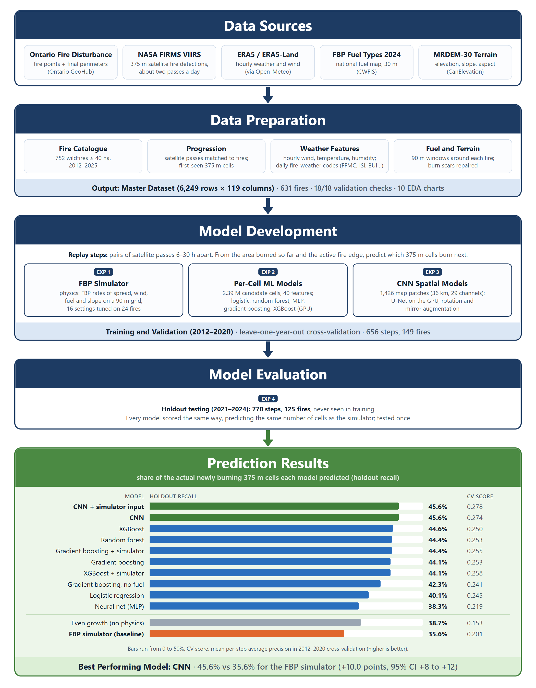

# AI capability 2: wind-driven fire spread

The project's second capability predicts **where an existing fire spreads
next**. Given a fire at one satellite pass and the weather until the next pass
(6–30 hours later), which 375 m cells will be newly burning? A physics model,
the Canadian FBP (Fire Behaviour Prediction) system on a 90 m grid, is the
baseline; ten learned models are compared with it on fires none of them saw in
training.

This folder is separate from the ignition panel in the repository root. None of
its data (final perimeters, final size, satellite detections, response type)
may be used as an ignition predictor.

**Headline.** All the learned models beat the FBP simulator. The best is a
spatial neural network (CNN, trained on the GPU): predicting the same area as
the simulator, it reaches **46%** of the newly burning cells against the
simulator's **36%**. It also ranks the cells that will burn half as well again
(average precision 0.33 against 0.22). The gap narrows on long runs, where every
model still under-predicts how far the head travels.

**Linked to capability 1.** The FBP simulator also runs from a single start
point, so it can follow on from the ignition model. Pick a 10 km cell the
ignition model scores on a 2019 day, and the simulator grows a fire from that
cell's centre ("what if a fire started here?"). For this, its two settings were
re-tuned on 2012–2016 fires only and tested on 2017–2018 and 2020–2024, so 2019
is never used. See [Linking with capability 1](#linking-with-capability-1-fbp-from-an-ignition-point).

## From raw data to results



## How the FBP simulator was built

The physics baseline is a simulator written for this project
(`scripts/spread_modeling/fbp.py`, `simulator.py`, and `scripts/fire_weather_index.py`).
It contains no code from another simulator. Its equations and constants come
from Canada's published fire science, the **Canadian Forest Fire Danger Rating
System (CFFDRS)**, which has two parts used here: the Fire Weather Index (FWI)
System and the Fire Behaviour Prediction (FBP) System.

### What each study contributed

| Study | What it gives the simulator | Where |
| --- | --- | --- |
| Van Wagner (1987), *Development and structure of the Canadian Forest Fire Weather Index System* | Daily fuel-moisture and fire-weather codes from noon temperature, humidity, wind and 24-hour rain: FFMC, DMC, DC, ISI, BUI, FWI | `fire_weather_index.py` |
| Van Wagner & Pickett (1985), *Equations and FORTRAN program for the Canadian FWI System* | Published test days, used to check our FWI code | `tests/test_fire_spread_dataset.py` |
| Van Wagner (1977), *A method of computing fine fuel moisture content throughout the diurnal cycle* | Hour-by-hour Fine Fuel Moisture Code, so moisture can change through the day | `fbp.py` (`hourly_ffmc`) |
| Forestry Canada Fire Danger Group (1992), *Development and structure of the Canadian Forest Fire Behavior Prediction System* (ST-X-3) | The FBP equations: rate of spread for each fuel type, the buildup effect, the fire ellipse (length-to-breadth), back-fire spread and the slope effect | `fbp.py`, `simulator.py` |
| Wotton, Alexander & Taylor (2009), *Updates and revisions to the 1992 Canadian FBP System* (GLC-X-10) | Revised FBP equations and constants used in place of the 1992 versions where they changed | `fbp.py` |
| Wang et al. (2017), *cffdrs: an R package for the Canadian Forest Fire Danger Rating System* | The Canadian Forest Service's reference implementation; our constants were checked against it (no code was taken) | checking only |

The fuel map is Natural Resources Canada's 2024 FBP fuel-type map, so every
cell already carries an FBP fuel type.

### How it turns the science into a spreading fire

1. **Weather to fire-weather codes.** Hourly reanalysis weather becomes daily
   codes (Van Wagner 1987) and an hourly fine-fuel moisture (Van Wagner 1977).
   During a step the day's FFMC and BUI are held, and only the wind changes
   hour by hour.
2. **Initial Spread Index (ISI).** Fine-fuel moisture and wind combine into
   ISI: `ISI = 0.208 × f(wind) × f(moisture)`, with `f(wind) = e^(0.05039 × wind)`
   up to 40 km/h. A second ISI with the wind reversed gives the back-fire rate.
3. **Rate of spread by fuel type (ST-X-3).** For each fuel type,
   `RSI = a × (1 − e^(−b × ISI))^c` with that type's published `a, b, c` (for
   example C-2 boreal spruce: 110, 0.0282, 1.5). The buildup effect then
   scales it for how dry the deeper fuel is:
   `BE = exp(50 × ln q × (1/BUI − 1/BUI₀))`.
   - **Mixedwood** (M-1/M-2) blends conifer (C-2) and aspen (D-1) rates by the
     map's percent conifer. The aspen part is cut to a fifth when the leaves
     are out.
   - **Aspen** spreads as leafless D-1, or as green D-2 (a fifth of the rate)
     only when BUI is 70 or more.
   - **Grass** (O-1a) is scaled by an assumed seasonal curing: 90% cured in
     spring, 50% in summer, 75% in autumn.
   - **Leaf-out** is taken as about 1 June to 15 September (days 152–258).
   - **Water and non-fuel** never burn.
4. **The fire ellipse (ST-X-3).** Wind stretches the fire downwind with a
   length-to-breadth ratio `L:B = 1 + 8.729 × (1 − e^(−0.030 × wind))^2.155`.
   The flank rate is `(head + back) / (2 × L:B)`, and the rate in any other
   direction follows the ellipse.
5. **Slope (ST-X-3).** A move uphill is sped up by `e^(3.533 × slope^1.2)`,
   with the slope (rise over run) capped at 0.7.

### What this project added

The FBP System gives the spread rate at a point. Turning that into a growing
fire on a map is this project's own design:

- **Grid:** a 90 m grid per fire, cut from the fuel map and the MRDEM terrain.
- **Spread:** fire moves between cells to 16 neighbours (the 8 adjacent cells
  and 8 "knight's moves"), using that hour's wind. Each move takes half its
  time in each cell's fuel.
- **Arrival times:** each cell's arrival time is the shortest travel time by
  any path (a shortest-path search), so fire flows around lakes and races
  through faster fuels.
- **Burn-scar repair:** the 2024 fuel map shows regrowth where these fires
  burned, so fuel inside each fire's final perimeter is replaced with the
  nearest fuel outside it. Lakes are kept.
- **Replay:** each step starts from the area burned at one satellite pass and
  spreads from the stretch of edge where flames were last seen.
- **Tuning:** two multipliers were tuned on 24 fires from 2012–2020: every
  rate × 0.8, and flank and back rates × a further 0.25 (Experiment 1). The
  link with capability 1 uses its own tuning that never sees 2019: rate × 1.3,
  flank × 0.1 (see [Linking with capability 1](#linking-with-capability-1-fbp-from-an-ignition-point)).

### How it was checked

The tests (`tests/test_spread_simulator.py`, `tests/test_fire_spread_dataset.py`) check:

- **FWI:** the code reproduces the Van Wagner & Pickett (1985) test days.
- **Spread rates:** C-2 follows the published equation; drier deep fuel
  spreads faster; mixedwood spreads faster with more conifer; green aspen
  carries fire only when the duff is very dry; water and non-fuel never burn.
- **Simulator:** the fire is round in calm air and long in wind, runs
  downwind as far as the head rate allows, goes around water, climbs faster
  uphill, and spreads only from the active edge.
- **Replay:** the code reproduces the published tuning scores exactly.

### What it leaves out

- **Crown fire:** the shift from surface to crown fire, foliar moisture,
  fire intensity and acceleration are not modelled. In the FBP System these
  change the spread rate mainly for C-6.
- **Spotting and suppression:** ember spotting and firefighting are not
  modelled.
- **Single run:** one deterministic run per step.

The project proposal named a Rothermel-based simulator. FBP was used instead
because Rothermel needs US fuel models, while Ontario's fuel map is in FBP
fuel types. The rest of the design (physics, wind, fuel moisture, fuel type,
slope, replay against dated fire growth) follows the proposal. How it differs
from Cell2Fire, the open-source FBP simulator, is in
[comparison_with_cell2fire.md](docs/modeling/comparison_with_cell2fire.md).

## Linking with capability 1: FBP from an ignition point

Capability 1 scores whether a 10 km cell has an ignition on a local day.
`scripts/spread_modeling/ignition_bridge.py` takes such a cell and day and grows
a fire from it with the FBP simulator. The ignition demo calls it from its
"What if a fire started here?" section (`/api/spread`). Full details are in
[ignition_bridge.md](docs/modeling/ignition_bridge.md).

### Why FBP and not the CNN

The CNN and the other learned models predict the *next* satellite pass from a
fire that already exists. They need its burned area, active front and previous
direction of spread. A predicted ignition has none of these. FBP needs only a
start point, a start time, fuel, terrain and weather, so it can start from
nothing.

### What one run does

1. **Start point and time.** The cell's centre, at a chosen hour (default
   14:00, the afternoon peak) in local standard time: CST west of 90° W,
   otherwise EST, as in the spread dataset. The ignition model gives only a day
   and a 10 km cell, so both are assumptions the user controls. If the start's
   90 m cell is water or non-fuel, it moves to the nearest burnable cell
   within 1 km.
2. **Inputs for a window around the start.** The window is 10–35 km from the
   start to each edge, depending on run length. The inputs are fetched and cached
   in `artifacts/ignition_bridge/`, so only the first run at a place needs the
   internet:
   - **fuel:** FBP Fuel Types 2024 at 90 m, from the same CWFIS service and
     lattice as the dataset's fuel windows;
   - **terrain:** MRDEM-30, warped to the same 90 m grid;
   - **weather:** hourly ERA5 / ERA5-Land at the start from Open-Meteo, from
     1 April (or 30 days earlier) so the FWI codes have a season of history. It
     goes through the dataset's own `daily_fire_weather` and hourly FFMC code.
3. **Burn-scar repair, but only for later fires.** The 2024 map shows scars of
   fires that burned after the start date. Inside the Ontario Fire Disturbance
   perimeters of fires that started on or after that date (through 2024), land
   gets the fuel of the nearest burnable cell outside. Older scars are kept,
   because they were real when the fire started.
4. **Spread.** `simulator.simulate` from the start cell for 6–72 hours with the
   bridge's tuned settings. The result carries every reached 90 m cell with
   its arrival time (up to 80,000 cells), the same rolled up to the 375 m
   satellite grid (earliest arrival per cell), the area burned by the end of
   each hour, and each hour's wind. The demo animates the fire from these. It
   also reports the area, the head distance and direction, the weather at the
   start, and whether the fire hit the window's edge.

A run takes 3–5 s once a place is cached, and about 30 s the first time.

### How the settings were re-tuned

The published tuning used 2 fires from 2019, the year the combined demo is
shown on. `scripts/spread_modeling/tune_simulator_bridge.py` re-tunes the same
two multipliers without it:

- **Split by year.** Tune on 2012–2016 (43 fires, 157 scored steps). Test once
  on 2017–2018 (59 fires, 302 steps) and on 2020–2024 (50 fires, 314 steps).
  2019 is never read. The fires are every trackable, monitored (`MON`) fire of
  500–30,000 ha, the same rule as Experiment 1, but all of them rather than a
  sample of 24. Test fires after 2019 only measure the chosen setting; they
  cannot change it.
- **Replay.** As in Experiment 1, each fire is replayed between satellite passes
  6–30 h apart, and the simulated new area is compared with the 375 m cells
  first seen burning at the next pass.
- **Grid search.** Every combination of 15 rate scales (0.2–1.6) and 11 flank
  scales (0.05–1.0), 165 settings, each replayed on all 43 tuning fires. That
  is about 5 minutes on 12 cores.
- **Objective (same as Experiment 1).** The simulated head should run as far
  as the observed head, and the simulated area should be 1.3 × the cells the
  satellite saw. The error is `|log(distance ratio)| + |log(area ratio / 1.3)|`,
  and the smallest wins; an exact tie goes to the higher overlap (IoU). Recall
  is not used to choose, because a bigger area always raises it.
- **Leakage guards.** The tuning script refuses tuning years from 2019 on and
  any split that contains 2019. The bridge refuses a settings file that breaks
  either rule.

**Chosen: rate × 1.3, flank × 0.1** (on 2012–2016: head distance ratio 0.79,
area ratio 1.30).

| Test steps | Setting | Recall | Even-growth recall | IoU | Even-growth IoU | Head distance ratio | Area ratio |
| --- | --- | ---: | ---: | ---: | ---: | ---: | ---: |
| 2017–2018 (302) | **chosen 1.3 / 0.1** | 0.191 | 0.200 | 0.091 | 0.079 | 0.51 | 0.62 |
| | published 0.8 / 0.25 | 0.270 | 0.284 | 0.103 | 0.095 | 0.66 | 1.13 |
| 2020–2024 (314) | **chosen 1.3 / 0.1** | 0.264 | 0.268 | 0.109 | 0.104 | 0.69 | 1.00 |
| | published 0.8 / 0.25 | 0.354 | 0.373 | 0.114 | 0.114 | 0.91 | 1.78 |
| All test (616) | **chosen 1.3 / 0.1** | 0.229 | 0.235 | 0.100 | 0.092 | 0.59 | 0.79 |
| | published 0.8 / 0.25 | 0.313 | 0.329 | 0.108 | 0.105 | 0.77 | 1.50 |
| Long runs ≥ 1.5 km (232) | **chosen 1.3 / 0.1** | 0.181 | 0.150 | 0.093 | 0.073 | 0.30 | 0.51 |

Even growth burns the same area as the setting it sits beside, so each pair of
columns compares like with like.

What this shows:

- **The chosen setting burns too little on later fires.** It hit the area
  target on 2012–2016 but reaches only 0.79 of it on the test fires, so its
  recall is below the published setting's, which burns about twice the area.
- **It still beats even growth on overlap.** Its IoU is higher than even
  growth's in both test periods (0.100 against 0.092 pooled). On long runs it
  beats even growth on recall too (0.181 against 0.150), so wind, fuel and slope
  help most where the fire runs. The published setting is slightly ahead on
  IoU (0.108).
- **The choice is fragile.** The error surface is a long, flat valley: a faster
  head with a narrower flank, or a slower head with a wider flank, gives much
  the same fire. Along the valley floor, rate × flank stays near 0.12–0.13
  on 2012–2016 fires (0.18 on 2012–2018). (1.3, 0.1) is an isolated dip in
  that valley on 43 fires, mostly from 2012.
  Tuned on all 102 fires from 2012–2018, the search picks rate × 0.9,
  flank × 0.2 instead.
- **Every setting under-predicts long runs.** Where the head ran 1.5 km or
  more, the simulated head reaches 0.30 of the observed distance, so spread
  maps will look small on blow-up days.

Every setting's tuning scores are in `docs/modeling/bridge_simulator_grid.csv`.
The report is `bridge_simulator_tuning.json` and the step scores are
`bridge_simulator_tune_steps.csv` and `bridge_simulator_test_steps.csv`.

### Limits of the linked run

- **Hindcast, not forecast.** The run uses the reanalysis weather that actually
  followed, which nobody had in advance.
- **Most high-scoring cells had no fire that day.** A spread run answers "what
  if a fire started here", not "a fire started here".
- **Post-2019 information in the inputs.** There is no 2019 fuel map, so the
  2024 map is used. Its later scars are repaired with perimeters of fires that
  burned after the start. Neither is used to tune the settings.
- **One deterministic run**, with no crown fire, spotting or suppression.

## How to run

Use Python 3.12 in an isolated environment. From the repository root:

```sh
python -m venv .venv-spread
.venv-spread/Scripts/python -m pip install -r capability_2_fire_spread/requirements.txt
cd capability_2_fire_spread
```

**Dataset build** (downloads public sources; scripts run in this order):

```sh
python scripts/download_fire_disturbance.py
python scripts/build_spread_fire_catalogue.py
python scripts/download_firms_viirs.py
python scripts/build_spread_progression.py
python scripts/download_spread_weather.py
python scripts/build_spread_weather.py
python scripts/download_spread_fuel_windows.py
python scripts/build_spread_fuel_summary.py
python scripts/download_spread_terrain_windows.py
python scripts/build_spread_terrain_summary.py
python scripts/build_spread_master.py
python scripts/validate_spread_master.py
python scripts/eda_fire_spread.py
```

The processed dataset is already in `data/processed/`. To run the experiments on
it, only the per-fire fuel and terrain windows and the perimeters are needed:
`download_fire_disturbance.py`, `build_spread_fire_catalogue.py` and the two
`download_spread_*_windows.py` scripts.

**Experiments** (`python -m` from this folder):

```sh
python -m scripts.spread_modeling.tune_simulator   # 1  tune the FBP simulator, score it on holdout fires
python -m scripts.spread_modeling.cell_table       #    per-cell table: features, labels, simulator prediction
python -m scripts.spread_modeling.train            # 2  the eight per-cell models
python -m scripts.spread_modeling.cnn_patches      #    map patches for the CNN
python -m scripts.spread_modeling.train_cnn        # 3  the two CNNs (GPU)
python -m scripts.spread_modeling.compare          # 4  every model against the simulator on holdout fires, once
python -m scripts.spread_viewer.export             #    the viewer: the CNN beside the FBP simulator on 3 test fires
python -m unittest discover -s tests -v            #    68 tests (see Testing)
```

Rough times on a laptop (16 cores, RTX 4050): cell table 2 min, per-cell models
about 3.5 h (gradient boosting is most of it), CNNs 35 min on the GPU,
comparison 4 min.

**Link with capability 1** (`python -m` from this folder):

```sh
python -m scripts.spread_modeling.tune_simulator_bridge   # re-tune FBP on 2012-2016, test on 2017-2018 and 2020-2024 (~6 min)
python -m scripts.spread_modeling.ignition_bridge --longitude -90.7 --latitude 50.9 --date 2019-05-29 --hour 14 --hours 24
```

The second command prints one run as JSON. The ignition demo runs the same
command for the selected cell. It needs the per-fire fuel and terrain windows
and the processed dataset for the tuning, and internet access the first time
the bridge runs at a new place.

## Results

### The dataset

752 Ontario wildfires of 40 ha or more from 2012–2025 with a final perimeter
(Ontario Fire Disturbance). Satellites (NASA VIIRS, 375 m) saw 631 of them;
their growth is rebuilt pass by pass into a master table of **6,249 rows ×
119 columns**, beside hourly ERA5 weather, fire-weather codes, FBP fuel types
(2024 map) and MRDEM terrain. 368 fires are *trackable* (three or more growth
steps). 2025's 69 fires wait on NASA's yearly archive.

| Split                        | Years      | Fires | Fires with satellite rows |  Rows |
| ---------------------------- | ---------- | ----: | ------------------------: | ----: |
| Calibration (tune and train) | 2012–2020 |   432 |                       392 | 3,242 |
| Holdout (test once)          | 2021–2024 |   251 |                       239 | 3,007 |

All 18 dataset validation checks pass (`data/processed/ontario_fire_spread_v1_validation.json`).
Details: [the dataset documentation](docs/fire_spread_dataset.md).

### Exploratory analysis

From [the EDA](docs/eda/README.md), ten charts:

- A few years and a few huge fires dominate: five years hold 60% of the fires,
  and the 65 fires of 10,000 ha or more (9%) are 75% of the 2.9 million ha burned.
- Satellites look about twice a day (median 12.2 h between passes), so steps
  shorter than 6 hours cannot be scored.
- Fires usually run downwind, but not reliably: 47% of runs in winds of 10 km/h
  or more are within 45° of downwind, against 25% if wind made no difference.
- Growth rises about sevenfold from the calmest to the most severe fire weather
  (median 28 ha per step at ISI under 2, 197 ha at ISI 15+), but the ranges overlap.
- The 2024 fuel map shows burn scars inside old perimeters; the simulator and
  models repair it from the fuel around each fire.

### Experiment 1: tuning the FBP simulator

Two settings were tuned on 24 calibration fires (89 steps) so the simulated
head runs as far as observed and the area is 1.3 times the cells seen. Part of
the 16-setting grid (`docs/modeling/simulator_scores.json` has all):

|    Rate scale |    Flank scale |          Recall | Head distance ratio |     Area ratio |
| ------------: | -------------: | --------------: | ------------------: | -------------: |
|           0.5 |            0.5 |           0.325 |                0.65 |           1.50 |
| **0.8** | **0.25** | **0.292** |      **0.65** | **1.25** |
|           0.8 |            0.5 |           0.432 |                0.99 |           2.62 |
|           1.2 |           0.25 |           0.382 |                0.96 |           2.12 |

No setting meets both targets; 0.8 / 0.25 is closest. On its 24 holdout fires
(150 steps): recall 0.302 (even growth 0.331), IoU 0.109, head direction within
45° on 56% of steps (chance 25%). On the 44 long-run steps (head ran ≥ 1.5 km) it
beats even growth (recall 0.265 against 0.192) but reaches only 0.36 of the
observed head distance. Method: [simulator.md](docs/modeling/simulator.md).

### Experiments 2 and 3: training the learned models

Mean per-step average precision (AP) in leave-one-fire-year-out
cross-validation on 2012–2020 (656 steps, 149 fires). Higher is better; the
simulator and even growth are scored on the same folds with nothing fitted.

| Model              | CV AP | Chosen setting             |
| ------------------ | ----: | -------------------------- |
| `cnn_hybrid`     | 0.278 | 40 epochs, width 32        |
| `cnn`            | 0.274 | 40 epochs, width 32        |
| `xgboost_hybrid` | 0.258 | 600 trees, depth 8         |
| `hgb_hybrid`     | 0.255 | 400 iterations, 15 leaves  |
| `random_forest`  | 0.253 | 200 trees, min 20 per leaf |
| `hgb`            | 0.253 | 400 iterations, 15 leaves  |
| `xgboost`        | 0.250 | 600 trees, depth 6         |
| `logistic`       | 0.245 | C = 1                      |
| `hgb_no_fuel`    | 0.241 | 400 iterations, 31 leaves  |
| `mlp`            | 0.219 | layers 64, 32              |
| FBP simulator      | 0.201 |                            |
| Even growth        | 0.153 |                            |

Model descriptions and training details: [learned_models.md](docs/modeling/learned_models.md).

### Experiment 4: every model against the simulator on holdout fires

Scored once on 2021–2024: **770 steps of 125 fires**. In *matched* mode every
model predicts exactly as many cells as the simulator in each step, so only
*where* it puts them differs. Recall is the share of newly burning cells
reached; IoU the overlap of predicted and observed new cells; step AP how well
a model ranks the cells that will burn (it needs no cell count). The interval is
the 95% range of the recall difference from the simulator, from resampling
whole fires.

| Model                    |          Recall |             IoU |       Precision |         Step AP | Direction within 45° | Recall vs simulator     |
| ------------------------ | --------------: | --------------: | --------------: | --------------: | --------------------: | ----------------------- |
| **`cnn_hybrid`** | **0.456** | **0.152** | **0.264** | **0.332** |                   60% | +0.100 [+0.081, +0.119] |
| `cnn`                  |           0.456 |           0.150 |           0.261 |           0.330 |                   59% | +0.100 [+0.079, +0.120] |
| `xgboost`              |           0.446 |           0.144 |           0.254 |           0.307 |                   55% | +0.090 [+0.073, +0.108] |
| `random_forest`        |           0.444 |           0.144 |           0.254 |           0.309 |                   58% | +0.088 [+0.071, +0.107] |
| `hgb_hybrid`           |           0.444 |           0.142 |           0.247 |           0.304 |                   55% | +0.088 [+0.070, +0.104] |
| `hgb`                  |           0.441 |           0.141 |           0.244 |           0.307 |                   57% | +0.085 [+0.068, +0.102] |
| `xgboost_hybrid`       |           0.441 |           0.141 |           0.244 |           0.297 |                   55% | +0.085 [+0.070, +0.101] |
| `hgb_no_fuel`          |           0.423 |           0.133 |           0.230 |           0.279 |                   54% | +0.067 [+0.048, +0.086] |
| `logistic`             |           0.401 |           0.125 |           0.221 |           0.272 |                   58% | +0.045 [+0.028, +0.062] |
| `mlp`                  |           0.383 |           0.120 |           0.212 |           0.252 |                   52% | +0.027 [+0.008, +0.046] |
| **FBP simulator**  |           0.356 |           0.113 |           0.204 |           0.221 |                   53% |                         |
| Even growth              |           0.387 |                 |                 |           0.200 |                       |                         |

Every learned model's IoU and step AP are also above the simulator's with
intervals that exclude zero, except the MLP's IoU (+0.007 [−0.001, +0.015]).

**On the simulator's own published 150 steps (22 fires)** the order holds:
`cnn_hybrid` recall 0.401 against 0.302 (+0.100 [+0.058, +0.146]), `cnn` 0.395,
`random_forest` 0.394, `xgboost` 0.382, `hgb` 0.375. Logistic regression (0.331,
+0.029 [−0.017, +0.076]) and the MLP (0.306) do not beat the simulator there.

**Long runs (observed head ran ≥ 1.5 km):**

| Steps                                 | Simulator recall |  `cnn_hybrid` | `cnn` | `xgboost` | `hgb` | `random_forest` |
| ------------------------------------- | ---------------: | --------------: | ------: | ----------: | ------: | ----------------: |
| All holdout, 270 steps                |            0.302 | **0.362** |   0.356 |       0.350 |   0.343 |             0.336 |
| Simulator's published fires, 44 steps |            0.265 | **0.288** |   0.266 |       0.248 |   0.246 |             0.242 |

Across all holdout fires both CNNs and the tree ensembles beat the simulator on
long runs (`cnn_hybrid` +0.060 [+0.043, +0.079], `random_forest` +0.034
[+0.015, +0.053]); the no-fuel ablation is borderline (+0.019 [+0.000, +0.038])
and logistic regression and the MLP are not clearly better. On the simulator's 44 long-run
steps only the CNNs match it and the per-cell models fall slightly behind, none
significantly. Every model under-predicts how far the head runs: the median
predicted/observed head distance on long runs is 0.53 for the simulator, 0.46
for the CNNs and 0.35–0.41 for the tree models.

**Each model choosing its own area** (all 770 steps):

| Model                   |          Recall |             IoU |       Precision | Area / observed | IoU vs simulator         |
| ----------------------- | --------------: | --------------: | --------------: | --------------: | ------------------------ |
| `cnn`                 |           0.374 | **0.185** |           0.304 |            1.33 | +0.072 [+0.058, +0.089]  |
| `cnn_hybrid`          |           0.352 |           0.181 | **0.310** |            1.23 | +0.069 [+0.055, +0.084]  |
| `random_forest`       | **0.380** |           0.175 |           0.290 |            1.38 | +0.063 [+0.050, +0.075]  |
| `hgb`                 |           0.345 |           0.174 |           0.299 |            1.19 | +0.062 [+0.047, +0.076]  |
| `xgboost`             |           0.349 |           0.172 |           0.297 |            1.18 | +0.059 [+0.046, +0.073]  |
| `logistic`            |           0.323 |           0.149 |           0.258 |            1.38 | +0.036 [+0.022, +0.050]  |
| `mlp`                 |           0.249 |           0.120 |           0.257 |            0.87 | +0.007 [−0.006, +0.019] |
| **FBP simulator** |           0.356 |           0.113 |           0.204 |            1.69 |                          |

The learned models predict a tighter area than the simulator and are much more
precise: the CNN reaches as many new cells as the simulator with a 64% larger
overlap.

### Experiment 5: weighting long runs in the CNN (not adopted)

The simulator does relatively better on big steps, so a CNN version
(`cnn_runs`) was trained to take long runs more seriously: each newly burning
cell counts `1 + w × its distance in km from the burned area` in the loss.
`w` = 0 is the plain CNN, rerun beside it. Chosen, as before, by
leave-one-year-out cross-validation on 2012–2020; recall here is at the
simulator's area, and big steps have 31 or more new cells (151 of 656).

| Long-run weight `w` | CV AP | Recall | Recall on big steps |
| ---: | ---: | ---: | ---: |
| **0 (plain CNN)** | **0.275** | **0.390** | **0.348** |
| 1 | 0.261 | 0.365 | 0.332 |
| 2 | 0.257 | 0.353 | 0.312 |
| FBP simulator, same folds | 0.201 | 0.317 | 0.290 |

The weighting made the CNN worse everywhere, including on the big steps it
targeted. With the number of predicted cells fixed, favouring distant cells
moves predictions away from the fire edge, where most new burning happens,
while the location of long jumps stays hard to predict. The plain CNN was kept,
so the 2021–2024 holdout was not used again. (In cross-validation the plain CNN
already beats the simulator on big steps, 0.348 against 0.290.)

### What the experiments show

1. **Learned models beat the FBP simulator at predicting where a fire grows
   next.** The CNN is best on every all-step measure; XGBoost, random forest and
   gradient boosting form a close second group. Logistic regression and the MLP
   gain least.
2. **Seeing the map helps.** The CNN reads the fire's whole neighbourhood and
   beats every model that judges one cell at a time, most clearly on long runs.
3. **The simulator's prediction adds almost nothing** to a learned model
   (`*_hybrid` against the plain versions): the learned inputs already carry what
   the physics adds.
4. **The leakage check passed.** Without any fuel input (`hgb_no_fuel`), gradient
   boosting still beats the simulator and loses only a little, so the repaired
   2024 fuel map is not giving away where each fire ended up.
5. **Big runs remain hard.** The advantage shrinks on long runs, and every
   model, the CNN included, under-predicts how far the head travels.

## Testing

`python -m unittest discover -s tests -v` (from this folder) runs six test
files, 68 tests in all. Unit tests use small synthetic inputs and run
anywhere; end-to-end tests use the real data, the generated cell table and the
fitted models, and are skipped when those files are absent (a fresh clone).

| File | Kind | Tests | What it checks |
| --- | --- | ---: | --- |
| `test_fire_spread_dataset.py` | Unit | 8 | Dataset build: FWI codes reproduce the Van Wagner & Pickett (1985) test days and use the preceding 24 h of rain; growth is measured from the nearest earlier cell; wind components follow the blowing-from convention; step weather covers the right hours; fuel shares and percent conifer; fuel windows snap to the source grid; slope and aspect of a known plane |
| `test_spread_simulator.py` | Unit | 15 | FBP simulator: ISI matches the FWI code; C-2 spread follows the published equation; drier deep fuel spreads faster; water and non-fuel never burn; green aspen burns only with very dry duff; more conifer spreads faster; the fire is round in calm air and long in wind; it runs downwind as far as the head rate allows; wind direction is where wind comes from; it goes around water; the flank setting narrows without slowing the head; the rate setting slows everything; it climbs faster uphill; it spreads only from the active edge |
| `test_spread_models.py` | Unit + real data | 11 | Model contract: no model uses an outcome or perimeter column; only hybrids see the simulator; the no-fuel ablation has no fuel; every family gets the same base features; top-k picking and the simulator's ranking; CNN rotations turn the wind arrows correctly and can be undone; zero long-run weight trains exactly the plain CNN; on a real fire, the replay reproduces the published simulator scores, a step's features do not change when every later satellite pass is deleted (no future information), and labels mark exactly the cells first seen at the next pass |
| `test_spread_pipeline.py` | Unit | 10 | Split and training: every fire is split by its year alone (2012–2020 / 2021–2024 / 2025); step AP is undefined without new burning and 1 for a perfect ranking; mean step AP skips steps without new burning; the area scale brings the median area ratio to 1.3; matched recall counts hits among the top k over all new cells; the fire bootstrap gives the mean inside its interval; every model family trains on rows with missing values and returns valid probabilities; each cross-validation fold leaves out exactly its year and the final fit uses every row; a forbidden feature stops training; training refuses rows from the test years |
| `test_spread_end_to_end.py` | End to end | 10 | Real data: no year crosses the split and no fire is on both sides; step, fire, row and positive counts match the build audit; the simulator's 150 published test steps are all included; rebuilding a test fire from the processed dataset gives exactly the saved cell-table rows; reloading every saved model (8 per-cell, 2 CNNs) reproduces its published recall on the 150 published steps; the simulator reproduces its published score; every model's headline recall is the mean of its 770 step scores; the CNN beats the simulator with a 95% interval above zero; every step score shown in the viewer equals the comparison's |
| `test_ignition_bridge.py` | Unit | 14 | Link with capability 1 (offline, synthetic grids): the window snaps to the fuel map's lattice and contains the start; it grows with run length within 10–35 km; local standard time follows the dataset; the start moves off water only to burnable fuel within 1 km; tuning years must end before 2019 and no split may contain 2019; ties go to the higher IoU; the bridge refuses settings tuned or tested on 2019; only scars of fires that started on or after the run date are repaired; in a uniform forest with a west wind the fire runs east; reached cells sit on the 375 m grid once each; the hourly burned area never shrinks and ends at the run's total, with one wind record per hour (the demo animation); longer runs burn more; no burnable fuel gives no spread with a reason; run length and start hour are validated |

### Latest run (2026-11-18)

| File | Result |
| --- | --- |
| `test_fire_spread_dataset.py` | 8 passed (0.2 s) |
| `test_spread_simulator.py` | 15 passed (0.2 s) |
| `test_spread_models.py` | 11 passed (33 s) |
| `test_spread_pipeline.py` | 10 passed (6.6 s) |
| `test_spread_end_to_end.py` | 10 passed (22 s) |
| **All** | **54 passed in 54 s** |
| All, without the generated files | 44 passed, 10 end-to-end tests skipped, no failures |

On 2026-11-19, after the link with capability 1 was added, the
`test_ignition_bridge.py` tests ran: 14 passed (0.8 s). The simulator tests
were run again (15 passed). So were the real-fire replay tests (3 passed),
which confirm the simulator still reproduces its published scores after its
weather preparation was moved into a shared function.

What the end-to-end tests confirmed on the real data:

- **Split:** training is 656 steps of 149 fires (1,062,522 candidate cells,
  15,913 newly burning), all from 2012–2020; testing is 770 steps of 125 fires
  (1,324,902 cells, 21,436 newly burning), all from 2021–2024; no fire is in
  both. The simulator's published test set is 150 steps of 22 fires.
- **Feature build:** a test fire rebuilt from the processed dataset matches
  the saved cell table exactly, cell for cell.
- **Saved models:** all 10 saved models reproduce their published recall on
  the 150 published steps to within 0.00006.
- **Results:** the simulator replays its published recall (0.3016 on 150
  steps); every model's headline recall equals the mean of its 770 step
  scores; the CNN's lead over the simulator has a 95% interval of +0.079 to
  +0.120.
- **Viewer:** every step score it shows (102 in all) equals the comparison's.

## Limits

- **Hindcast, not forecast.** The simulator and every model are given the
  weather that actually happened during each step, not a forecast.
- **Satellite cells are a lower bound.** A pass sees only active flames, so
  observed new cells under-count what burned; recall is the fairer rate.
- **Final-perimeter footprints.** Each fire's grid window, the satellite
  matching and the fuel repair use its final perimeter; this affects the
  simulator and the learned models alike.
- **Coverage.** Learned models score cells within 6 km of the fire (96.5% of new
  burning); fires with windows over 150,000 90 m cells are left out of the
  learned-model comparison.
- **Small search, single runs.** Two to four settings per family, one CNN
  architecture, each model fitted once.
- **No crown fire, spotting or suppression** in the simulator; 212 of the 752
  fires had full suppression.

See also: [how our simulator compares with Cell2Fire](docs/modeling/comparison_with_cell2fire.md).
