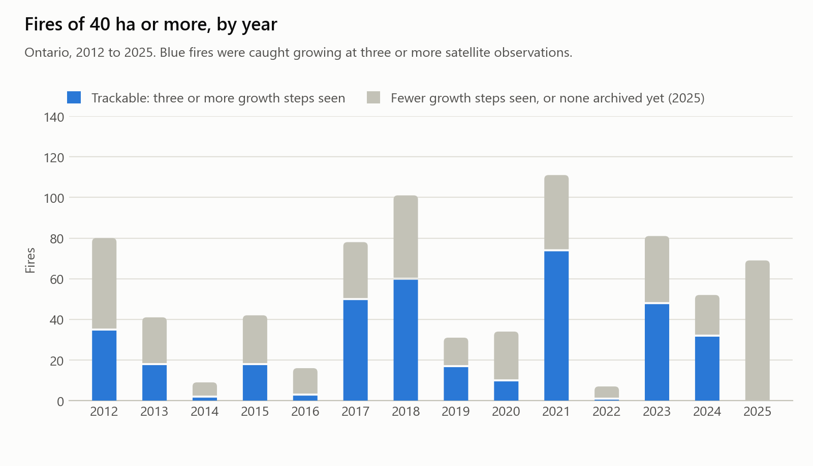
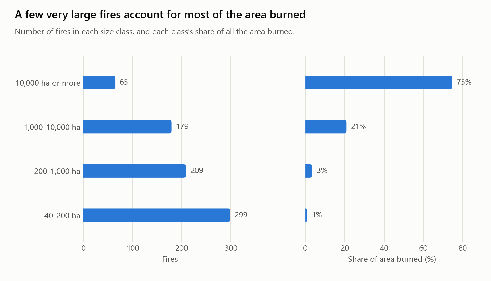
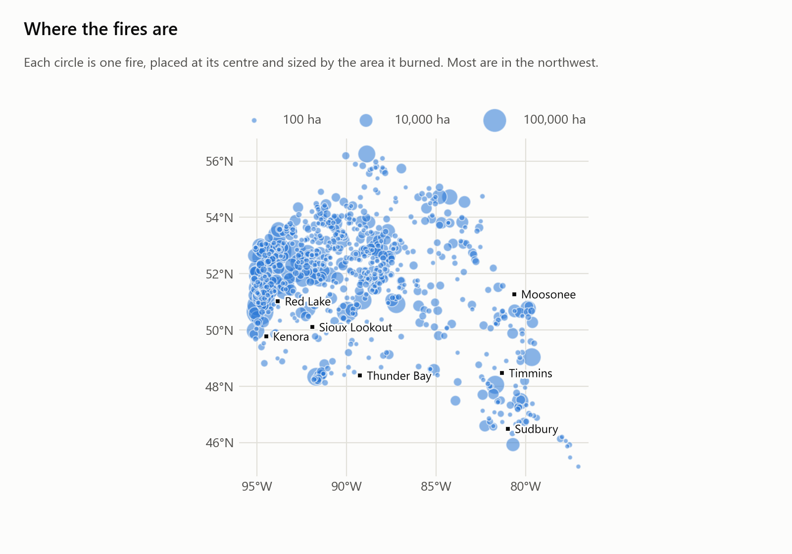
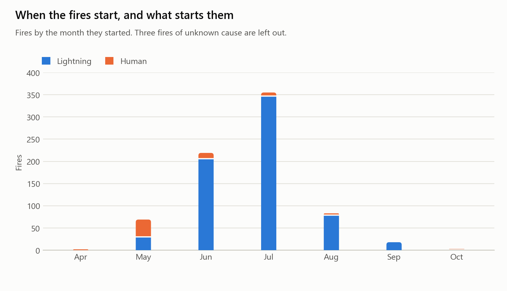
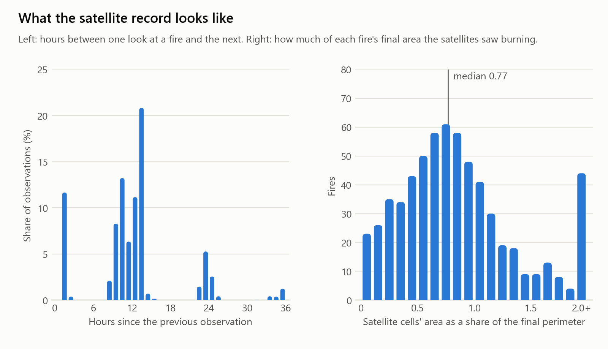
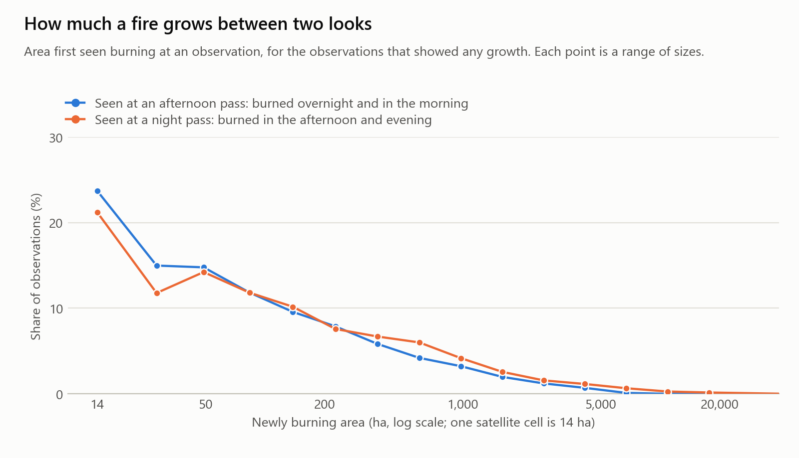
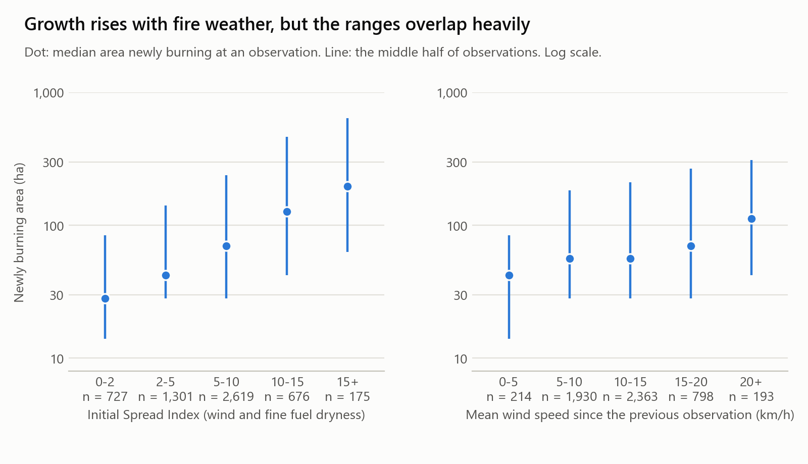
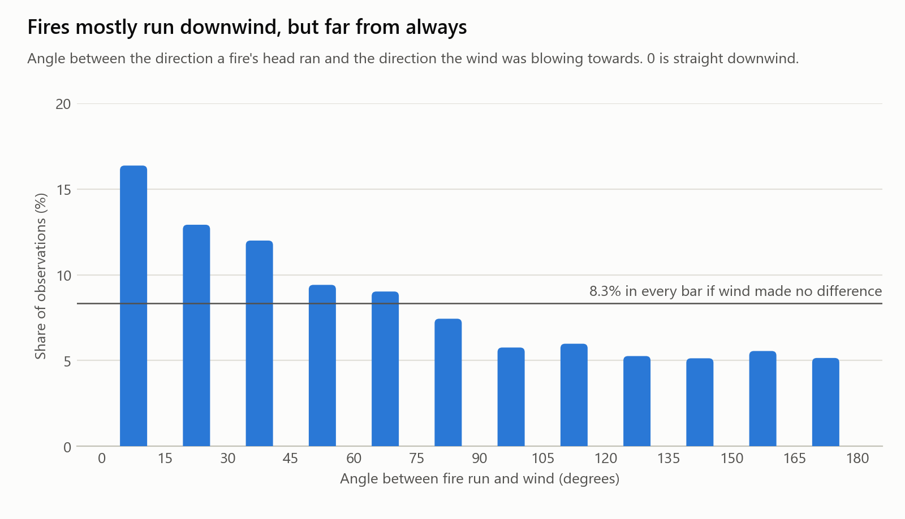
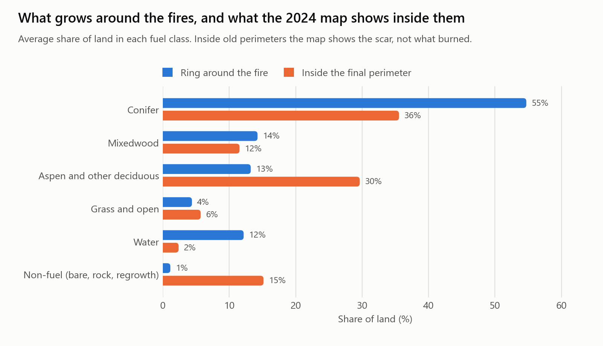
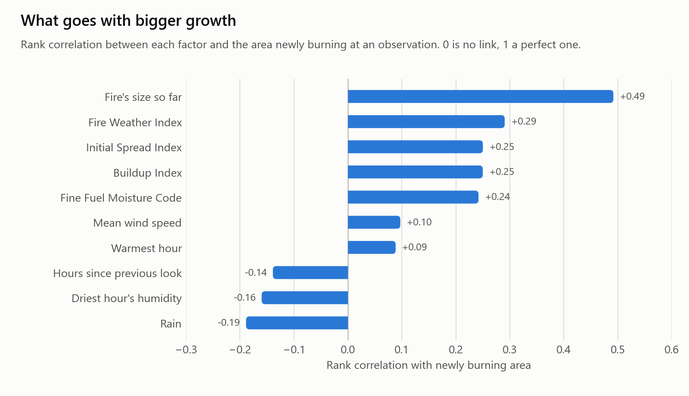

# Fire-spread dataset: exploratory analysis

Ten charts of the fire-spread dataset (v1), each with what it shows and why it
matters for the spread simulator. They are drawn from the fire list (752
fires) and the master table (6,249 satellite observations of 631 of those
fires).

To redraw them:

```sh
python scripts/eda_fire_spread.py
```

The figures are written to `docs/eda/`, and every number quoted below is in
`docs/eda/eda_numbers.json`.

## Main findings

- **The data is dominated by a few fire years and a few huge fires.** Five
  years hold 60% of the fires, and the 65 largest fires account for 75% of the
  area burned.
- **Satellites look about twice a day.** That sets the shortest step the
  simulator can be checked on, and it is why 1-hour and 3-hour predictions
  cannot be scored.
- **Fires usually run downwind, but not reliably.** 41% of fire runs are
  within 45° of the wind direction, against 25% if wind made no difference.
- **Weather explains only part of the growth.** Growth rises about sevenfold
  from the calmest to the most severe fire weather, but the ranges overlap
  heavily, and wind speed on its own is a weak signal.
- **The fuel map shows burn scars, not what burned.** Inside old fire
  perimeters the 2024 map shows far less conifer and far more regrowth and
  non-fuel than the land around them.

## 1. Fires by year



**What it shows.** The dataset has 752 fires of 40 ha or more from 2012 to
2025. Fire years are very uneven: 2021 (111 fires), 2018 (101), 2023 (81),
2012 (80) and 2017 (78) together hold 60% of them, while 2022 has 7 and 2014
has 9. Blue fires are the 368 flagged `trackable`: satellites caught them
growing at three or more observations. The 69 fires of 2025 are all grey
because the satellite archive for that year was not yet published.

**Why it matters.** The simulator is tuned on 2012–2020 and tested on
2021–2024. Both periods contain big and quiet years, so the test is not on an
unusually easy or hard stretch. Fires from 2025 can be added once their
satellite record is released.

## 2. Fire sizes



**What it shows.** Most fires are small: 299 (40%) are between 40 and 200 ha,
and the median fire is 344 ha. But the area burned is almost all in the
largest fires: the 65 fires of 10,000 ha or more are 9% of the fires and 75%
of the 2.9 million hectares burned. The largest single fire is 196,974 ha.

**Why it matters.** A score averaged over fires treats a 50 ha fire and a
100,000 ha fire alike. Large fires also give many more satellite
observations, so they dominate any score counted per observation. Results
should say which of the two they are.

## 3. Where the fires are



**What it shows.** Each circle is a fire, sized by the area it burned. The
fires are concentrated in the northwest: the Sioux Lookout, Red Lake,
Nipigon and Cochrane districts hold 624 of the 752 fires (83%). There are few
large fires in the south and east.

**Why it matters.** The simulator is tuned mostly on remote northern fires,
and 63% of the fires in the dataset were monitored rather than fully fought.
It has seen little of southern Ontario, so its settings should not be assumed
to hold there.

## 4. Season and cause



**What it shows.** The season peaks sharply in July (355 fires, 47%), with
June second (219). Lightning starts 681 of the fires (91%) and people 68
(9%). Human-caused fires are mostly a spring matter: they are the majority in
May (39 of 69), before the leaves are out and the summer lightning begins.

**Why it matters.** Spring and summer fires burn in different conditions.
Aspen and mixedwood carry fire much more easily before leaf-out, and grass is
dry in spring. The simulator switches those fuel rules by date, and this
chart shows that only a small share of the data (about one fire in ten) tests
the spring rules.

## 5. The satellite record



**What it shows.** Left: the time between one satellite observation of a fire
and the next. Observations come in clumps: about 100 minutes apart on
back-to-back orbits (12% of gaps are under 3 hours), then around 10–13 hours,
then 24 hours. The median gap is 12.2 hours, and 72% of gaps are between 6 and
30 hours. A further 13.5% are longer than 36 hours and are not drawn; the
likely causes are cloud and spells when the fire was quiet.

Right: for each fire, the area of the satellite cells seen burning, as a share
of the fire's final mapped area. The median is 0.77, so satellites typically
catch about three-quarters of a fire. Values above 1 are small fires, where
the 375 m satellite cells are coarse enough to overshoot the perimeter.

**Why it matters.** This is the main limit on testing the simulator. With a
look every 12 hours or so, a prediction for the next 1 or 3 hours has nothing
to be compared with; only steps of about 6 hours or more can be scored. And
because satellites miss about a quarter of the burned area, the observed
growth is a lower bound, which is why the simulator's "area" target was set
above the observed area.

## 6. Growth between observations



**What it shows.** How much new area was seen burning at each observation,
for the 88% of observations that showed any growth. Growth is usually small:
the median is 56 ha, which is four satellite cells, and over a fifth of
observations add a single cell. A few steps are enormous: 1% exceed 4,300 ha.

The two lines split observations by the time of the pass. Night passes (about
2 am) show what burned through the afternoon and evening, and they record
somewhat more growth (median 70 ha, top tenth above 824 ha) than afternoon
passes (about 1 pm), which show what burned overnight and in the morning
(median 56 ha, top tenth above 574 ha). The difference is consistent across
the range but modest.

**Why it matters.** Most steps move the fire by only a cell or two, which is
too little for wind direction to show up at 375 m. The simulator's skill can
only really be judged on the larger runs, which is why its scores are also
reported for steps where the fire ran 1,500 m or more. The modest
day-and-night difference is also why the simulator keeps one fuel-moisture
value for the whole day: letting spread nearly stop overnight would
contradict what the satellites saw.

## 7. Growth and fire weather



**What it shows.** Growth grouped by the Initial Spread Index (left) and by
mean wind speed (right). Each dot is the median growth in that group and each
line covers the middle half of observations. Median growth climbs from 28 ha
at the lowest spread index to 197 ha at the highest, about seven times. For
wind speed alone the rise is smaller, from 42 ha to 112 ha.

The lines overlap heavily. At a spread index of 5–10, the middle half of
observations runs from 28 to 239 ha; at 15 and above it runs from 63 to
640 ha. A quiet step in severe weather and a big step in mild weather are
both common.

**Why it matters.** Fire weather shifts the odds of a big run but does not
decide it. This is the main reason the simulator under-predicts big runs and
only partly beats a simple baseline: the inputs it is driven by carry a real
but limited signal. The weather data is likely part of the reason: it comes
from a coarse grid with one series per fire, not from the fire front.

## 8. Spread direction and wind



**What it shows.** The angle between the direction each fire's head ran and
the direction the wind was blowing towards, over 5,418 observations. The bars
fall steadily from left to right: 41% of runs are within 45° of straight
downwind, where 25% would be expected if wind made no difference, and 67% are
within 90°. The median angle is 59°.

**Why it matters.** This is the strongest evidence in the dataset that wind
direction carries real information, and it supports building a wind-driven
simulator at all. It also sets a ceiling: about a third of observed runs go
across or against the reported wind. Possible reasons include local winds,
terrain, lakes, fuel and firefighting. A simulator that follows the reported
wind cannot get those right. On unseen fires the simulator puts 56% of runs within 45° of the
observed direction.

## 9. Fuel inside and around the fires



**What it shows.** The average share of land in each fuel class, for a ring
of land around each fire (blue) and for the land inside its final perimeter
(orange), both read from the 2024 fuel map. Around the fires the land is 55%
conifer. Inside them it is only 36% conifer, with 30% deciduous and 15%
non-fuel, against 13% and 1% outside.

**Why it matters.** The fuel map dates from 2024, after most of these fires.
Inside an old perimeter it shows the scar and the young growth that followed,
not the forest that burned. Fed that map as it is, the simulator would try to
burn a 2018 fire through its own regrowth. So inside each perimeter the
simulator replaces the mapped fuel with the fuel of the nearest land outside
it, leaving lakes in place. The ring outside is the better guide to what
burned, and it says these are mostly conifer fires.

## 10. What goes with bigger growth



**What it shows.** How strongly each factor goes with the area newly burning
at an observation, as a rank correlation (0 means no link, 1 a perfect one).
The strongest by far is the fire's size so far (+0.49): big fires have long
edges and grow by more. The fire-weather indices follow at +0.24 to +0.29.
Mean wind speed alone is weak (+0.10). Rain (−0.19) and humid air (−0.16) go
with less growth, as expected.

**Why it matters.** Three things follow for the simulator. Starting each step
from the fire's real current shape matters more than any weather input, which
is how the replay is set up. The combined indices are better guides than raw
wind or temperature, which supports using the Canadian fire-weather codes.
And no single factor comes close to explaining growth, so a modest score is
what this data allows, not only a flaw in the simulator.

## Limits of this analysis

- Growth is measured in 375 m satellite cells, so anything smaller than
  14 ha is invisible and small steps are coarse.
- Satellites record fire only where it is active at a pass and the sky is
  clear, so observed growth is a lower bound.
- Weather is one reanalysis series per fire, not the wind at the fire front.
- Correlations here are across all observations of all fires. Large fires
  contribute many more observations than small ones.
- These charts describe the spread dataset only. None of its columns may be
  used as predictors in the ignition dataset.
