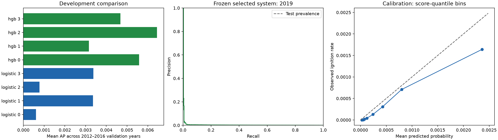
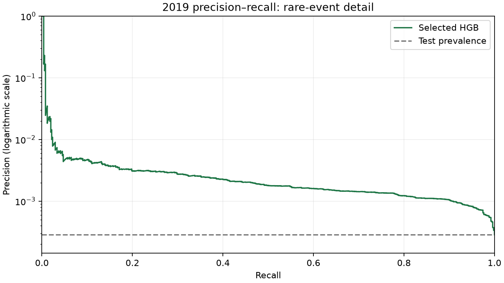

# Executed ignition model comparison

Selected **histogram gradient boosting**, candidate 2, by mean development AP **0.006449**. Frozen 2019 test AP **0.007275**, against test prevalence **0.000286**.

## What was executed

Nine roles completed discovery, source auditing, split design, preprocessing, two model implementations, evaluation and independent verification. Full original-panel validation passed 277 checks. Both model families were fitted on every training row across five expanding chronological folds; no resampling or validation/test rebalancing was used. Logistic regression uses averaged SGD with logistic loss and L2 regularization to keep memory bounded. Three epochs are a declared optimization budget and do not prove convergence. HGB uses native NaN, class weights once and external chronological iteration selection; internal early stopping is disabled.

## Data and feature contract

The original panel contains 17,798,320 rows and 7,785 positive cell-days. Its daily weather missingness was 52.48%; the model cache corrects future-station selection and unsorted archive joins. Corrected daily weather missingness is **7.17%**, and prior-seven-day rain missingness **12.20%**. All original rows/labels/calendar/terrain/history are preserved. Cache version: `ignition-v1-weather-asof-global-date-v2`.

Inputs originate from exactly 36 approved predictors. Logistic preprocessing adds 21 fixed missing/censor indicators (57 transformed columns); HGB adds only the history-censor indicator (37 columns). IDs/dates/source metadata and all three label fields are excluded. Training-fold medians/scales are fitted inside each fold. Entirely missing nullable training columns use 0 as a numerical fallback with an explicit indicator, never as a statement that censored fire history equals zero days.

## Frozen partitions

| Partition | Local dates | Rows | Positive cell-days |
|---|---|---:|---:|
| Development/final base-model fit |2010-05-01–2016-10-31 (May–October)|12,458,824|5,290|
| Calibration fit |2017-05-01–2017-10-31|1,779,832|736|
| Calibration choice/threshold tradeoffs |2018-05-01–2018-10-31|1,779,832|1,250|
| Locked final test |2019-05-01–2019-10-31|1,779,832|509|

Validation years 2012–2016 each train on 2010 through the preceding year. Whole dates remain together. The target horizon is one local day beginning at 00:00 America/Toronto; weather/history are prior-date inputs, and label windows do not overlap, so purge gap is 0.

## Development results

| Family | Best mean validation AP | Configuration |
|---|---:|---|
|logistic|0.003373|`{"alpha": 0.001, "batch_size": 50000, "class_weight": "balanced", "epochs": 3}`|
|hgb|0.006449|`{"class_weight": null, "l2_regularization": 1.0, "learning_rate": 0.1, "max_iter": 40, "max_leaf_nodes": 15, "min_samples_leaf": 100}`|

AP, the ranking criterion, uses the full natural-prevalence validation sets; prevalence is the no-feature ranking reference. Model choices use development data only.

## Single frozen final evaluation

AP=0.007275; ROC-AUC=0.889195; Brier=0.00028565; log loss=0.00230542. Baseline AP=0.000286. Sigmoid calibration used: **False**; fitted only on 2017 and compared against raw scores on 2018. Final selected system was frozen before 2019 predictions.

No operating threshold is selected because no alert budget/error costs were specified. The saved 2018 score-quantile thresholds define tradeoffs; the same thresholds were evaluated unchanged on 2019. False alerts are negative cell-days flagged, reported per 10,000 evaluated cell-days and per distinct local date. Counts and precision/recall are in `test_threshold_tradeoffs.csv`.





### Examples of frozen threshold tradeoffs

| Threshold | Precision | Recall | Alerts/day | False alerts/day |
|---:|---:|---:|---:|---:|
|0.001520|0.20%|44.40%|604.78|603.55|
|0.006316|0.50%|4.72%|26.23|26.10|
|0.027926|2.14%|1.57%|2.03|1.98|
|0.044013|5.41%|0.79%|0.40|0.38|

These are examples from the eight thresholds frozen using 2018 scores. They are not recommended operating points. Ranking improves over the prevalence baseline, but absolute precision remains low and false alerts dominate. ROC-AUC is a ranking statistic, not classification accuracy.

## Artifacts and reproduction

Tracked here: feature/source/split/gate/verification reports, execution configuration, development comparison, calibration decision, final freeze/results and charts. Generated cache/model/prediction binaries remain in ignored `data/interim/ignition_modeling_cache/` and `artifacts/ignition_modeling/full_run/`. The saved `selected_system.joblib` contains the complete fitted pipeline, optional calibrator, exact schema and frozen thresholds. Reload with joblib and predict using `scripts.ignition_modeling.run.predict_bundle`; inputs must follow the approved 36-column order and the corrected past-only feature rules.

```powershell
python -m pip install -r requirements-modeling.txt
python -m scripts.ignition_modeling.validation --input '<original audited CSV>' --chunk-size 50000
python -m scripts.ignition_modeling.data --input '<original audited CSV>'
python -m unittest discover -s tests -v
python -m scripts.ignition_modeling.run --smoke --output artifacts/ignition_modeling/smoke
python -m scripts.ignition_modeling.run
python scripts/publish_ignition_modeling_report.py
```

Recover the manifest-pinned CWFIS archive before rebuilding the cache. The training gate requires the full data, leakage and corrected-cache verification described in the accompanying reports. Existing final-test output is never overwritten; a correctness-defect rerun requires a new output directory and disclosure. Exact versions/seeds/code fingerprints and pipeline checksums are saved in configuration/freeze files.

## Limits

This is a retrospective hindcast on the frozen v1 grid, whose edge-cell selection uses study-period events. Archive publication/revision times are unknown, and static terrain is a retrospective approximation. Results do not establish operational forecasts, unbiased performance outside this grid, future climate/station coverage performance, or HRDPS readiness. Censored history begins in 2010. Spatial-block generalization and date-dependent uncertainty estimates were not executed. Optimization is bounded, and the small candidate search is not exhaustive. No test-driven tuning was performed.
