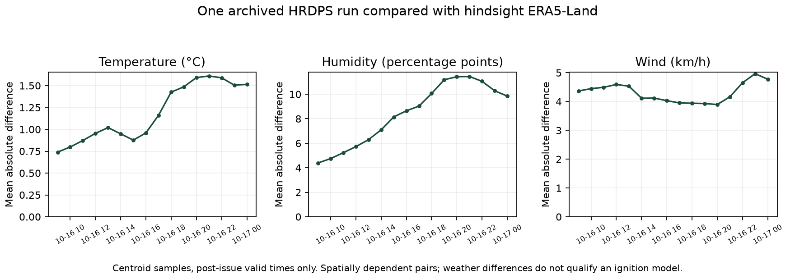

# Live forecasting qualification work

November 1, 2026. The missing matched-reference weather case has been supplied and measured. **Live ignition remains unavailable**, with HTTP 503 and a null probability. One weather comparison does not qualify the ignition model, moisture-code state or forecast horizons.

## Actual acquired sources and matching

Using existing local CDS access, downloaded ERA5-Land temperature, dewpoint, earth-relative U/V wind and accumulated precipitation for October 15–17, 2026, over the current 9,648-cell centroid domain. The reference download is 13,648,297 bytes; its request, retrieval time and SHA256 are in `era5_acquisition.json`. Three official CWFIS station files (October 15–17) were also retrieved and hashed. Raw files and paired full tables remain local; Git receives compact methods/results/manifests.

The forecast is the pinned **October 16 00 UTC HRDPS** run already downloaded by the project, available locally at **08:12:37 UTC**. Exact `(grid_id, valid_time_utc)` pairing yields **154,368** post-issue rows, 16 future valid hours on all 9,648 centroids, with no unmatched eligible keys. Another 77,184 forecast rows with valid times at/before issue were excluded. These hours span two UTC calendar dates but represent **one forecast run/issue**, not two independent validation days.

The project previously had zero local ERA5/HRDPS date overlap. That narrow data-availability blocker is resolved for this archived case. The new API evidence reports the measured pairs and one independent run; the original dated readiness record remains unchanged.

## Units, geometry and clock checks

ERA5-Land is an independent **hindsight reanalysis reference**, not observed ground truth or a historical issue-time input. Its temperature is converted K→°C, dewpoint yields RH, earth-relative wind becomes km/h, and its source-specific accumulated rain is deaccumulated with the existing reset-aware decoder. HRDPS already uses validated GRIB units, rotated-grid wind correction and metadata-bounded rain intervals. The comparison uses preceding-hour rainfall, not an unlabelled cumulative amount or daily total.

Both are sampled at the same declared 10 km-grid centroids using their native cells; this is not a conservative area average. Regular geographic coordinate units, transforms, variable grids, contiguous UTC clocks, earth-relative reference wind, exact valid times, unique keys, positive forecast leads and issue availability are checked. Original forecast and state-checkpoint content hashes and the centroid-grid hash are verified. Missing or invalid values remain excluded separately per variable and counted explicitly.

| Variable | Finite pairs | Invalid/missing pairs | Bias (forecast-reference) | MAE | RMSE | Unit |
|---|---:|---:|---:|---:|---:|---|
| temp_c | 154,176 | 192 | -0.8696 | 1.1907 | 1.5320 | degC |
| rh_pct | 154,162 | 206 | 5.6906 | 8.4125 | 10.7050 | percentage points |
| wind_kmh | 154,176 | 192 | 2.3342 | 4.3108 | 5.6714 | km/h |
| precip_mm | 153,780 | 588 | 0.0002 | 0.0846 | 0.2056 | mm per preceding hour |



All plotted timestamps are UTC. These pairs are spatially and temporally dependent. The large row count does not provide 154,368 independent samples or a confidence interval for forecast skill. Land masks, native sampling and reanalysis uncertainty contribute to differences. No bias correction was fitted on this case.

## FWI state and equation diagnostic

The CWFIS daily format contains repeated header rows and padded text. The new adapter removes those headers, checks the requested report date and station-key uniqueness, strips padding, converts units already supplied by that source, and preserves invalid/sentinel values as missing. It does not turn archive station rows into trusted grid states.

There are 2,045 station identities shared by October 15 and 16, with 1,894 finite weather/code pairs. Using published previous-day station moisture codes plus the next day's published weather, the team's equations differ from reported values by mean absolute amounts **0.0584 FFMC, 0.0488 DMC, 0.0485 DC and 0.0305 FWI**. This is a useful independent reported-data consistency diagnostic across the source's Canadian network, not an Ontario-only check or canonical certification. Published rounding, initialization, station details and quality flags can differ. The 0.15 closeness count in the JSON is descriptive, not an approved acceptance threshold.

The source CSV lacks latitude/longitude and per-record historical availability timestamps. Its `OPTS` and `CALCSTATUS` values are retained; their full quality/startup meaning has not been independently accepted. A file retrieved November 1 does not prove that the moisture state was available at the October 16 issue. No exact grid/noon mapping or overwintering lineage has been accepted. Therefore **trusted issue-verified observed grid states remain zero**.

New guards reject forecast/startup checkpoints promoted merely by `trusted=true`; trusted seed input also requires an observed state kind and source hash. The stricter qualification validator checks the exact previous standard noon, state date, timezone, source lineage and availability before issue. Metadata checks cannot create missing scientific evidence. Checkpoints generated after a forecast update continue to be labelled forecast-derived and untrusted.

## Why activation still fails

1. **State lineage:** acquire an authoritative previous-standard-noon observed/overwintered FFMC/DMC/DC source, source quality/startup interpretation, current location/timezone metadata, reviewed grid mapping and evidence of receipt before the intended issue. Preserve the chain through subsequent updates. Historical download timestamps cannot be backdated.
2. **Issue and feature compatibility:** the existing selected-source ignition model uses prior-day retrospective ERA5 features at a midnight Toronto issue. This weather case's 08:12 UTC retrieval occurs after that day's midnight issue. Forecast-day HRDPS values cannot simply replace prior-day observed/reanalysis features. Register and build the intended source/lead/availability/target contract first.
3. **Repeated validation:** one archived run is too narrow. Collect and pin independently issued runs and later references across wet/dry conditions and the active fire season. Partition by issue date, keep source transformations fitted on development only, and reserve later runs/labels for evaluation. Consider 30+ issue dates as a collection planning target, not an accepted scientific threshold.
4. **Model acceptance:** evaluate a model using that exact feature contract, target horizon and timely state, including source shift, probabilities and fixed-capacity recall. Establish an accepted validation decision before emitting live probabilities. This work does not manufacture such a decision.
5. **Season/domain:** a successful autumn weather check is not fire-season or cross-year ignition qualification. The spread reconstruction and its displayed 1/3/6-hour controls remain separate from forecast validation.

No additional account/credential was required for the completed comparison. The remaining external information is authoritative state/location/time/quality lineage and an accepted forecasting protocol; it is not a code toggle. Do not contact providers or deploy production without separate user authorization.

## Code, integration and verification

New `scripts/acquire_live_reference.py` reproduces the bounded source acquisition; `--download` uses existing local CDS configuration without copying keys. New `scripts/live_qualification.py` builds the exact paired case, station diagnostics and an explicitly unavailable readiness record. The application reads the new record if present, falls back to its older dated record for older packages and rejects any edited evidence file that tries to return a live score. The old scientific result files are unchanged.

The combined prototype suite now passes **180 tests**. New tests exercise chronological feature windows, missing days, new target semantics, spatial training exclusions, reference units/wind orientation, exact cell-time pairing, availability, station parsing, state lineage and fail-closed integration. **14 fresh HTTP checks** passed on port 8770, preserving both saved-score examples, details and exports while returning current 503/null live evidence. HTTP tests are not a fresh visual browser rehearsal. Direct local and static code review was performed; independent human/agent approval is not claimed. Static complexity findings in legacy export/seed code and moderate validation branching are recorded; the new reference reader's high-complexity function was split and rechecked.

The updated local runtime copies are `CAPSTONE/scripts/capstone_app.py` and `hrdps_live_weather.py`; their Git-owned sources are under `github_iteration_1/prototype_iteration_1/scripts`. Existing running processes need restart to load changed Python source. The review server was started separately on port **8770**, leaving existing demo processes alone.

From `github_iteration_1/prototype_iteration_1`:

```sh
../../.venv/bin/python -m scripts.acquire_live_reference --workspace ../.. --output-dir ../../reports/live_reference_repeat_01 --download
../../.venv/bin/python -m scripts.live_qualification --workspace ../.. --output-dir ../../reports/live_reference_repeat_01
../../.venv/bin/python -m pytest tests team_repository/tests team_repository/capability_2_fire_spread/tests -q
```

Acquisition uses a fresh output directory and current public availability; a future source revision may change hashes. Do not overwrite the completed case. Omitting `--download` writes only a request plan and does not contact services. The existing October 16 forecast bundle must also be restored from local storage for reproduction. It is not contained in a fresh Git clone.

## Primary source references

[ERA5-Land catalogue](https://cds.climate.copernicus.eu/datasets/reanalysis-era5-land?tab=overview) describes the reanalysis source. [Official HRDPS documentation](https://eccc-msc.github.io/open-data/msc-data/nwp_hrdps/readme_hrdps-datamart_en/) describes the forecast grids, issues and fields. [CWFIS station downloads](https://cwfis.cfs.nrcan.gc.ca/downloads/fwi_obs/current/) provide the retrieved daily reports. [NRCan's Weather Guide](https://publications.gc.ca/collections/collection_2009/nrcan/Fo134-8-2008E.pdf) documents the noon-weather and moisture-code context. Source documentation does not substitute for the missing issue-time/state evidence in this case.
