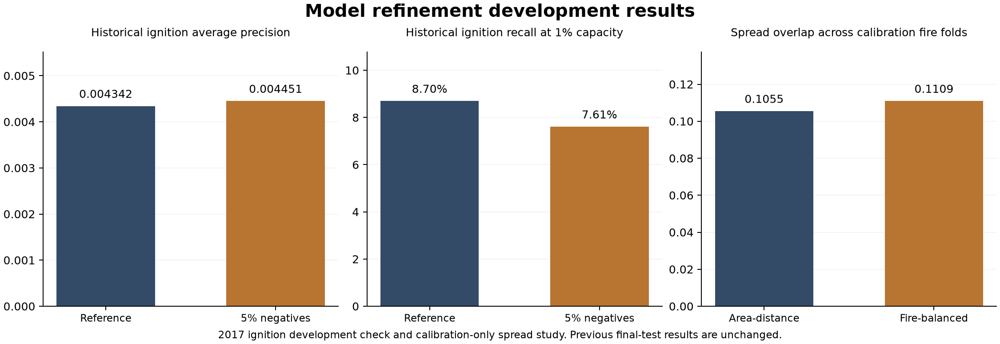

# Model refinement development report

October 31, 2026. The professor's feedback, as relayed by the student, was to strengthen the models before extending the frontend.

This round completed 26 historical rolling-fold fits, three calibrated historical development bundles, 12 selected-source rolling-fold fits and one selected-source refit. It also tested two spread calibration policies across 22 whole-fire folds. The larger historical negative sample improved average precision slightly but reduced the number of recorded starts found at fixed capacity. No replacement passed the full adoption checks, so the existing application models and spread settings remain in place. These are useful negative findings; they do not establish stronger operational prediction.



## What changed

The four original model families remain the historical-rate baseline, logistic regression, histogram gradient boosting and LightGBM. The historical experiment compared seven specifications, including denser negative sampling, a shallower regularized LightGBM and removal of fire-history predictors. The spatial experiment compared six because its existing contract already excludes history. Every positive training row was retained; either 1% or 5% of non-fire rows was sampled deterministically by cell/date key. Inverse sampling weights restore the actual training population's event rate. Class-prior distortion through `scale_pos_weight` was not introduced.

Historical model choices used two forward folds: fit 2010–2013 and validate 2014; fit 2010–2014 and validate 2015. Selection required higher mean average precision, no reduction in mean recall at the existing 1% daily capacity, and no fold average precision below 90% of the reference. The choices were written to `selection_freeze.json` before the later development check. Geographic fitting retained the existing deterministic 100 km blocks and 20 km centre buffer, excluding both inner-validation and outer-reserved cells.

The selected models were refit on 2010–2015, recalibrated using 2016 and checked on 2017. Spatial recalibration used only training geography; 2017 geographic checking used the separate inner-validation geography. This is stronger separation within development, but all these years were examined in earlier project work. Consequently, it is development confirmation rather than a new independent final test. The original 2018 calibration, 2019 final test, 2025 final periods and saved spread holdout observations were not used for this round's fitting or selection. Their existing output artifacts passed hash checks.

The separation follows the [scikit-learn guidance for time-dependent evaluation](https://scikit-learn.org/stable/modules/cross_validation.html). The tree refinements use leaf size, depth and regularization controls described in the [LightGBM parameter documentation](https://lightgbm.readthedocs.io/en/latest/Parameters.html).

## Historical ignition findings

Both compared temporal models received the same newly defined refit and recalibration schedule. These numbers must not be compared directly with the previously reported 2019 final score as if they were the same experiment.

| 2017 development metric | Reference LightGBM | 5% negative sample |
|---|---:|---:|
| Eligible cell days | 1,779,832 | 1,779,832 |
| Recorded positive cell days | 736 | 736 |
| Average precision | 0.00434155 | 0.00445058 |
| ROC AUC | 0.866279 | 0.865233 |
| Brier score | 0.000412688 | 0.000412642 |
| Log loss | 0.00324567 | 0.00323775 |
| Recall at 1% daily capacity | 8.70% | 7.61% |
| Precision at that capacity | 0.359% | 0.314% |
| Positive cell days found | 64 | 56 |
| Total selected cell days | 17,848 | 17,848 |

Average precision rose 2.51% relative to the reference and probability losses improved slightly. At the fixed 1% capacity, however, the candidate found eight fewer positive cell days. The paired seven-day block bootstrap interval for the recall change is [-2.56, 0.15] percentage points. This conditional development interval does not establish an improvement. The denser model remains a research candidate and is not promoted.

The geographic reference found 0 of 92 positive cell days at the 1% capacity in the separate 2017 inner-validation geography, with average precision 0.002140. No alternative met the preregistered rolling-fold safeguards. The zero-hit result is a concrete generalization problem, not a satisfactory geographic acceptance result. A zero difference interval when the chosen model equals the reference is an identity comparison, not evidence of certainty about geographic skill.

Saved gain-importance tables show DMC and neighborhood fire-history inputs among the largest temporal contributors; the spatial model uses weather and terrain without history. Gain importance is a diagnostic of fitted splits, not a causal explanation of errors. Removing history reduced performance in these folds rather than resolving geographic transfer.

## Selected seven-source study

The 2025 panel remains a separate model/data contract. The candidates fit May and validated June, then fit May–June and validated July. The six specifications were fixed before those comparisons. August calibration and September–October final observations were excluded. No new source or landscape vintage was added.

| Candidate | June average precision | July average precision | June recall at 1% | July recall at 1% |
|---|---:|---:|---:|---:|
| historical_rate | 0.000567 | 0.000344 | 1.22% | 0.00% |
| logistic | 0.001180 | 0.002303 | 1.83% | 11.65% |
| histogram_reference | 0.004292 | 0.002911 | 5.49% | 11.65% |
| lightgbm_reference | 0.007429 | 0.002805 | 6.10% | 10.68% |
| lightgbm_dense | 0.003352 | 0.002584 | 6.71% | 6.80% |
| lightgbm_regularized | 0.003395 | 0.003078 | 4.88% | 10.68% |

The existing LightGBM specification remained selected under the same cross-month safeguards. A fresh May–July development bundle was saved with save/load parity. It is explicitly uncalibrated and must not replace the existing application probability bundle. These two monthly checks do not establish cross-year generalization; the panel still has only one fire season.

## Spread findings

The spread work reused the 1,424 archived calibration replay rows for 16 parameter pairs over 89 observation steps from 22 scoreable fires. It did not rerun physical simulations or score the old holdout. Two additional registered calibration fires had no scoreable steps. Each outer fold excluded one complete fire before selecting parameters on the remaining fires. This avoids treating multiple observations of the same fire as independent validation cases.

| Mean across excluded calibration fires | Area and distance rule | Fire-balanced overlap rule |
|---|---:|---:|
| Intersection over union | 0.105479 | 0.110920 |
| Recall | 0.390062 | 0.347682 |
| Matched-area even-growth overlap | 0.097250 | 0.106625 |

The paired whole-fire bootstrap interval for the overlap change was [-0.008933, 0.019037], spanning zero. Recall also fell. The current rate scale 1.2 and flank scale 0.25 are retained. The simulator still uses final-perimeter-assisted reconstruction inputs and retrospective weather. This study does not validate live spread forecasts or the displayed one-, three- and six-hour horizons.

## Delivered evidence and acceptance

The new code is in `scripts/model_refinement.py`, `scripts/selected_model_refinement.py` and `scripts/spread_refinement.py`. Nineteen new tests cover reserved-period exclusion, nested sampling, geographic separation, predictor allowlists, complete candidate comparisons, fixed-population paired uncertainty, whole-fire separation, matched replay support and invalid metrics. The combined prototype suite passed **148 tests**; the repository suite passed **56 tests and 12 subtests**. Model save/load predictions matched. Earlier scientific artifacts retained their recorded hashes. Source snapshots preserve the code used for each run.

The code-review skill's static checks and a direct review were completed locally; no independent human or agent review is claimed. The stricter spread input validation was verified to reproduce every actual metric and selected setting exactly. Static quality tools also flagged explicit experimental constants, parameter counts and a few function-complexity thresholds; those are recorded rather than described as an independent approval. No frontend, serving default, old submission file or original final result was changed.

New serialized models remain local under `data/processed/ignition_refinement_2026-10-31` and `data/processed/selected_refinement_2026-10-31`. They are development artifacts, not a deployment release. Input manifests record the full data hashes; large model/data artifacts remain outside Git.

## Next model milestone

1. Keep the reference defaults. The new historical candidate has an AP/recall trade-off and neither the selected-source candidate nor the spread calibration alternative passed the replacement gates.
2. Investigate the zero-hit geographic result using source coverage, fuel/forest representation and weather-history dynamics. Any additional historical predictor must be available in the correct year; current FBP or SCANFI maps cannot be backfilled into 2010–2017 without a valid dated contract.
3. Version the next feature experiment and its acceptance rule before fitting. Prioritize consistent recall at the agreed review capacity and credible calibration, alongside average precision. Do not change capacity after inspecting a result to manufacture an improvement.
4. Add genuinely later-season or later-year data from the same selected sources and register a new untouched evaluation. The old 2019 and 2025 final periods are exposed and cannot become new clean tests by rerunning them.
5. For spread, require reliable initial-state and time-matched progression evidence before claiming forecast skill. Keep reconstruction separate from operational prediction.

## Reproduce the development studies

From `github_iteration_1/prototype_iteration_1`, use the existing CAPSTONE Python environment and restore the pinned source panels and calibration replay CSV documented in the input manifests. The Git snapshot alone does not contain those full generated inputs. These commands create new output versions and do not overwrite the completed run:

```sh
../../.venv/bin/python -m scripts.model_refinement --workspace ../.. --output-dir ../../reports/model_refinement_repeat_01 --model-dir ../../data/processed/ignition_refinement_repeat_01
../../.venv/bin/python -m scripts.selected_model_refinement --workspace ../.. --output-dir ../../reports/selected_refinement_repeat_01 --model-dir ../../data/processed/selected_refinement_repeat_01
../../.venv/bin/python -m scripts.spread_refinement --workspace ../.. --output-dir ../../reports/spread_refinement_repeat_01
../../.venv/bin/python -m pytest tests team_repository/tests team_repository/capability_2_fire_spread/tests -q
```
