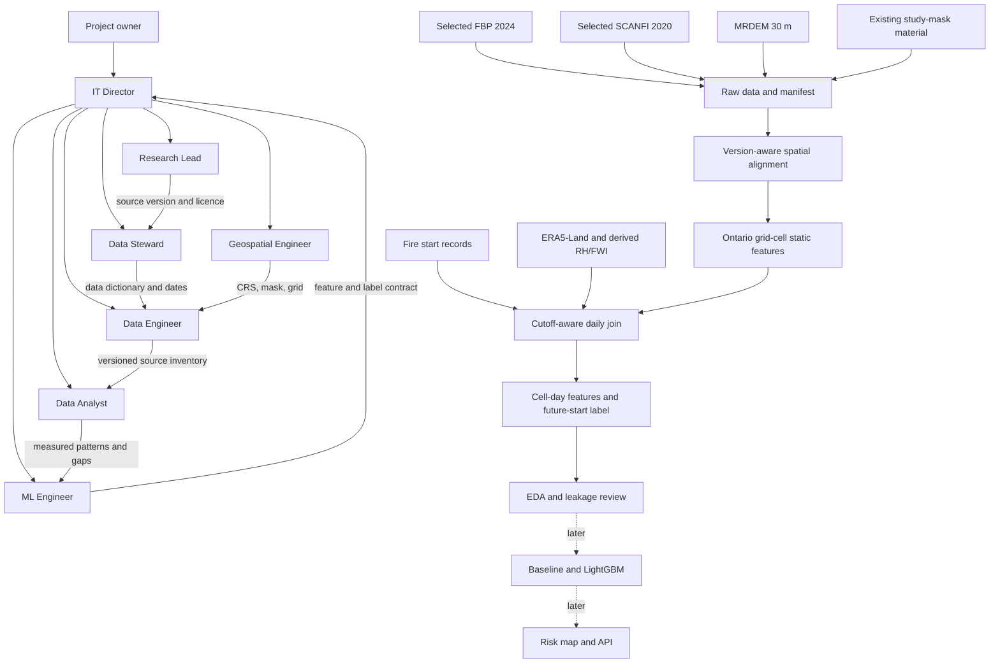
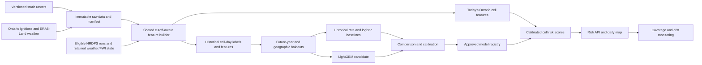
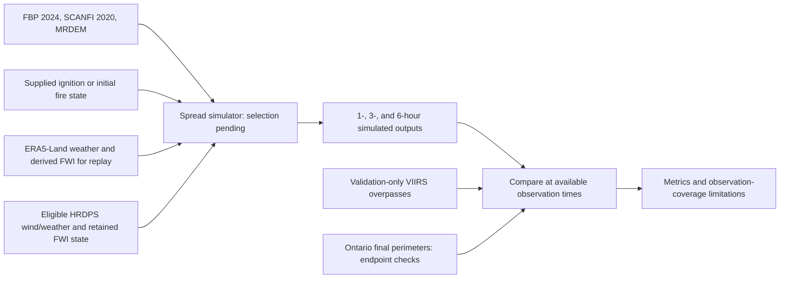

# Ontario-wide static data exploratory analysis

## Scope and method

This analysis covers the dissolved union of the 95 polygons in Ontario's historical Fire Management Zone layer, about 1,074,886 km². The boundary is a reproducible study mask, not a current operational response map. The Ontario downloads contain 145 intersecting 100 km tiles for FBP 2024, nine SCANFI v2 2025 layers, and MRDEM 30 m, plus the official national one-band FBP 2026 GeoTIFF. The manifest records 1,598 files with sizes and SHA-256 checksums. The separate Fire Response Plan Area vector is limited to northwestern Ontario and is not an all-Ontario replacement mask.

The 2024 fuel distribution was counted at native 30 m resolution: 1,192,615,430 valid pixels of 1,194,128,205 Ontario-mask pixels. The remaining raster results use a systematic sample at approximately 300 m spacing within each native raster and the mask, yielding about 11.9 million sampled locations per layer. Values below are descriptive estimates over this mask, not fire-risk or feature-importance estimates. Source rasters have different native CRSs; the mask was transformed to each CRS before sampling. The 2024 and 2026 fuel rasters were profiled separately, with their own legends.

## Inventory and coverage

| Source | Local material | Sampled valid coverage | Observed range or content |
| --- | --- | ---: | --- |
| [FBP Fuel Types 2024](https://open.canada.ca/data/en/dataset/4e66dd2f-5cd0-42fd-b82c-a430044b31de) | 145 categorical 30 m tiles | 99.873%; exact full-resolution count agrees | 15 observed codes |
| FBP Fuel Types 2025 | No official public 2025 raster located by 2026-10-02 | — | Missing requested vintage; do not interpolate |
| [FBP Fuel Types 2026](https://open.canada.ca/data/en/dataset/851e6a27-a250-41e6-9cd0-d7ff96455dd6) | One official, one-band national 30 m raster | 99.941% | 14 observed codes |
| [SCANFI v2](https://open.canada.ca/data/en/dataset/07653869-f303-46c2-a04e-9ab479b73cbf), 2025 | Canopy closure, height, seven species closure groups; 145 tiles each | 99.941% per layer | Closure 0–100%; height 0–90 m |
| [MRDEM DTM](https://open.canada.ca/data/en/dataset/18752265-bda3-498c-a4ba-9dfe68cb98da) | 145 elevation tiles, native EPSG:3979 | 100.000% | Sampled −662.6 to 676.4 m; mean 250.5 m |
| [Historical Ontario Fire Management Zone](https://ws.lioservices.lrc.gov.on.ca/arcgis1071a/rest/services/LIO_OPEN_DATA/LIO_Open09/MapServer/32) | 95 polygons | Study mask | All features have 2005-04-01 business-effective dates |
| [Ontario Fire Response Plan Area](https://ws.lioservices.lrc.gov.on.ca/arcgis1071a/rest/services/LIO_OPEN_DATA/LIO_Open09/MapServer/33) | 8,823 unique response-area features | Northwest only | Latest observed effective date 2025-04-14 |

## Measured patterns

**Fuel classes.** In the full-resolution 2024 Ontario mask, code 2 (C-2 Boreal Spruce) accounts for 26.7% of valid pixels, code 102 (water) 16.4%, code 31 (matted grass) 10.1%, code 13 (aspen under the 2024 legend) 9.8%, and code 11 (leafless aspen) 8.6%. The approximately 300 m sample gives the same leading proportions. In the 2026 sample, code 2 is 24.5%, water 17.2%, code 650 10.2%, code 13 9.1%, code 31 8.0%, and code 3 7.9%. These are distributions of two separately produced maps, not measured landscape change. The [2026 publisher description](https://open.canada.ca/data/en/dataset/851e6a27-a250-41e6-9cd0-d7ff96455dd6) specifically redefines code 13 as vegetated fuel without an effective FBP match; the 2024 code-13 label must not be applied to 2026.

**Forest structure.** SCANFI 2025 mean canopy closure is 35.0%; 63.9% of sampled valid locations have a nonzero value. Mean canopy height is 7.34 m, with 63.9% nonzero. Canopy closure and height have Pearson r = 0.8823 over 11,911,823 paired sampled pixels. This is association among predictors and is not evidence that either predicts ignition.

**Species composition.** Mean crown closure by group is black spruce 13.65%, broadleaf 10.46%, jack pine 4.86%, tamarack 2.36%, other conifer 1.51%, balsam fir 1.32%, and white/red pine 0.82%. The seven group values sum to the total canopy-closure value at every one of the 11,911,823 paired sample locations. Black spruce is the largest individual mapped group. Treat total closure as an exact derived quantity when all seven groups are present.

**Terrain.** Sampled MRDEM elevation averages 250.5 m with standard deviation 124.3 m. Negative elevation occurs at 2,654 of 11,919,282 valid sampled locations (0.022%). Those values should be spatially reviewed before deriving slope; the profile alone does not establish whether they represent water, a vertical-reference issue, or an error.

**Regional pilot.** A separate 432-cell, 2.5 km pilot near Red Lake, Thunder Bay, and Timmins found conifer to be the largest mapped group in Red Lake (45.6%) and Timmins (40.8%), while water was the largest in the Thunder Bay sample (33.1%). These figures describe the pilot windows only; see [the pilot EDA](static_dataset_eda.md).

## Candidate features and exclusions

| Decision | Feature | Reason |
| --- | --- | --- |
| Prioritize | Versioned FBP class and neighborhood class shares | Represents fuel context; use a separate class dictionary per vintage and track unmapped/unknown classes. |
| Prioritize | Black spruce, jack pine, broadleaf, and other SCANFI species closure values | Describes forest composition; keep the seven groups as a coherent set until outcome-based selection. |
| Prioritize | MRDEM elevation, derived slope, circular aspect | Terrain affects local conditions; derive slope/aspect from aligned elevation with attention to water and edge artifacts. |
| Evaluate for redundancy | Total canopy closure and canopy height | Closure equals the sum of species groups exactly; height correlates strongly with closure. Compare ablations after labels exist. |
| Use only where appropriate | Fire Response Plan Area | Northwestern coverage only, and policy areas can change; use a version available at the prediction time. |
| Exclude from predictors | Historical FMZ polygon ID/designation | Useful as a study mask or reporting stratum, but 2005 zones could make the model learn administrative geography instead of fire conditions. |
| Exclude | Raw numeric FBP code, future raster vintages, final fire size/perimeter | Treat FBP as categorical. A raster published after the prediction date leaks future information; final outcomes cannot be predictors. |

Predictive importance cannot be ranked from these static rasters alone. Fire-start outcomes and dated weather with derived RH/FWI have not yet been joined. The 2025 SCANFI and 2026 FBP layers describe current-state EDA material, but historical training rows require versions that existed at each prediction cutoff. The team's 2026-10-09 source selection uses FBP 2024 and SCANFI 2020; do not silently replace them with these newer EDA products.

## Recommended next sequence

The team selected seven source groups: Ontario Fire Disturbance Point + Area, FIRMS VIIRS, ERA5-Land, HRDPS, FBP 2024, SCANFI 2020, and MRDEM. Their roles and limitations are recorded in [the team source contract](data_dictionary.md#team-source-contract--2026-10-09). RH/FWI are derived from weather; separate lightning and access datasets are outside the selected scope. This sequence includes the planned spread simulator alongside the ignition classifier; the measured EDA above remains a static-data analysis.

1. Fix the prediction unit and cutoff, for example an Ontario 2.5 km cell at a daily morning cutoff, with a next-day fire-start label. Confirm that fire records support the chosen time precision.
2. Review the software architecture against ignition and spread requirements before implementing the cell-day training pipeline. Identify stakeholders, compare architectural alternatives, document component interfaces and significant decisions, and assess construction, deployment, and maintenance risks. Define simulator initialization and 1-/3-/6-hour output horizons separately from the next-24-hour ignition label. Use the architecture-review checklist below; existing diagrams are a draft design, not operational software.
3. Acquire and validate historical ignition records. Deduplicate events, assign starts to cells and prediction windows, and establish sufficient observation coverage before assigning no-fire labels.
4. Build a dated registry for the seven selected source groups. Acquire ERA5-Land and validation-only VIIRS, establish HRDPS ingestion, and verify the selected SCANFI 2020 product. Keep existing FBP 2026 separate as EDA material; select only eligible vintages and pre-cutoff weather inputs for prediction evaluation.
5. Complete a shared feature builder and produce one row per grid cell per day. Derive RH, wind, rain summaries, and stateful FWI. Align static rasters, use nearest-neighbor resampling for categorical fuel codes and area aggregation for continuous forest/terrain fields, preserve nonfuel/water/missing/unmapped classes separately, and join dated predictors and future-start labels.
6. Profile geographic and temporal coverage, missing values, and class imbalance. Make spatial and year-based holdouts, then build reusable preprocessing pipelines with learned transformations fitted only within training data.
7. Compare historical-rate and logistic-regression baselines with LightGBM using PR-AUC, calibration, and recall at a fixed alert budget. Assess feature importance only after labels exist; fit calibration separately from model fitting.
8. Build and evaluate the spread simulator using historical weather, fuels, vegetation, and terrain. Validate against matched VIIRS overpasses and final-perimeter endpoint checks; report unavailable validation windows rather than assuming hourly ground truth.
9. Build and validate HRDPS-driven daily scoring, spread outputs, the map, explanations, and input-coverage monitoring. Resolve FWI-state initialization, recent-weather history, and reanalysis-to-forecast feature consistency. Review the architecture and working prototype after each sprint before stakeholder demonstrations.

## Course deliverables — Weeks 3–5

The following checklist incorporates the Week 3, 4, and 5 summaries supplied on 2026-10-09. It is a work/evidence plan, not confirmation of LMS completion. Review the online content and key terms, attend the professor discussion/weekly meeting, and update the technical report in every week. Meeting attendance, feedback, formal report integration, and submission have not been verified.

| Week | Required technical-report update | Evidence needed to complete the technical work | Current local status |
| --- | --- | --- | --- |
| 3: AI capability design | Explain how the proposed ignition classifier and spread simulator meet the business problem. Describe their separate input/output contracts, approach, requirement links, evaluation criteria, limitations, and design rationale. | Requirements-to-design mapping, capability diagrams, model/simulator rationale, and recorded professor feedback where provided. | Design diagrams and capability descriptions are drafted. Formal technical-report integration and review are unverified. |
| 4: Feature engineering and framework choice | Include the seven-source contract, cleaning and missing-value policies, feature definitions/units, preprocessing pipeline, framework selection criteria, and software-architecture review. | Reproducible feature-building output, dated feature/label schema, comparison of framework alternatives against performance/community/flexibility/ease/cost, component interfaces, and architecture decision records. | Static EDA and the pilot feature table exist. Historical labels/weather joins, RH/FWI implementation, formal framework comparison, and architecture review are pending. |
| 5: Development, prototype, and individual-module testing | Describe implemented modules and a working prototype. Report test cases and results, prototype evidence, defects/fixes, predictive metrics where actually measured, and remaining limitations. | A reproducible small-area historical pipeline with real labels and predictions, a map demonstration, module-test results, integration-run evidence, and a separately evaluated spread prototype when implemented. | Static acquisition/analysis scripts and tests exist. No dated model-training pipeline, trained predictor, spread simulator, or end-to-end application prototype has been verified. |

The Week 5 prototype should start with a manageable region and a historical period supported by the selected dataset vintages. Demonstrate ingestion → labels/features → baseline → saved model → historical scoring → map output before expanding coverage and connecting live HRDPS. Report the spread-simulator path separately; a working ignition prototype does not complete spread validation.

### Week 5 module-test checklist

Test each implemented module as it is developed, then run the full prototype path. Tests should verify behaviour against independently specified expectations rather than reproduce the implementation.

| Module | Meaningful checks to implement and report |
| --- | --- |
| Source ingestion and labels | Schema/units, valid dates and coordinates, duplicate-event handling, cell assignment, label-window boundaries, observation coverage for negatives, and location/date uncertainty. |
| Static feature builder | CRS alignment, categorical FBP mapping, water/nonfuel/missing handling, fuel-share sums, selected SCANFI version/species semantics, and terrain slope/aspect units. Retain existing static tests and extend only for changed behaviour. |
| Weather and derived features | Temperature/wind/rain unit conversions, precipitation accumulation/reset handling, RH reference cases, trailing-window boundaries, FWI reference cases and moisture-code continuity, and local-standard-time noon alignment. |
| Cutoff and model pipeline | Reject post-cutoff observations and ineligible vintages, exclude final-outcome fields and validation-only VIIRS from classifier inputs, separate time/geographic holdouts, and fit learned preprocessing only within training folds. |
| HRDPS adapter and scoring | Preserve issue/availability/valid times, cover the requested forecast window, enforce the feature schema and units, maintain recent-weather/FWI state, and make missing or stale inputs visible in outputs. |
| Spread simulator | Check initial state, fuel support, units, time advancement, and simulator-specific reference cases. Match validation by event and actual VIIRS acquisition time; report unsupported horizons. |
| Integration and map | Run a small real-data path, save reproducible artifacts, ensure mapped cells/timestamps match the predictions, display probabilities within 0–1, and distinguish historical replay from live forecasts. |

The existing [validation report](validation_report.md) records seven passing static-pilot tests from 2026-10-02. They have not been rerun for this documentation update and do not verify future weather, model, simulator, or application modules. Store new results with their run date, data/model version, commands, and limitations. Update the technical report after each week's work and professor feedback; do not mark planned tests or prototypes as completed.

## Proposed prediction models

The first task should be **ignition probability**, not fire spread: for each 2.5 km Ontario cell at a fixed daily cutoff, estimate the probability of at least one new fire start before the next cutoff. Verify that ignition records have sufficiently precise dates and locations before making this the final target. Fuel and terrain describe the landscape; they do not provide observed fire starts or same-day fire weather.

| Model | Purpose | Decision rule |
| --- | --- | --- |
| Historical-rate reference | A season-and-region rate to beat | Use as the minimum benchmark, with rates fit only from earlier observations. |
| [Logistic regression](https://scikit-learn.org/stable/modules/generated/sklearn.linear_model.LogisticRegression.html) | Transparent baseline using the same dated features | Retain if a more complex model does not improve held-out results. |
| [LightGBM binary classifier](https://lightgbm.readthedocs.io/en/stable/Features.html) | Candidate for nonlinear weather, fuel, vegetation, and terrain interactions | Advance only if it improves future-year and held-out-region results; supply fuel codes as version-aware categorical values. |

Compare PR-AUC, recall at a fixed daily alert budget, and [probability calibration](https://scikit-learn.org/stable/modules/calibration.html). Reserve later years and geographic blocks for evaluation; ordinary random row splits can mix nearby cells and future information into training. Fit any calibrator on data separate from model fitting. The team's planned spread simulator has a separate initialization/output contract and validation path; ignition classification metrics do not establish its accuracy. Simulator selection and implementation remain pending.

## System architecture

### Module 4: review architectural designs for software

Status as of 2026-10-09: system and training/scoring diagrams are drafted. The formal architecture review, decision validation, and end-to-end prototype are pending. This step follows the course's architecture-review guidance; it does not claim compliance with an architecture-description standard.

| Review item | Required project output |
| --- | --- |
| Stakeholders and concerns | Identify the project team, instructor/evaluators, and intended risk-map users. Record concerns about reproducibility, prediction quality, understandable outputs, feasibility, and maintainability. |
| Components and connectors | Describe raw-data storage, spatial alignment, weather/RH/FWI processing and retained state, the shared feature builder, training/evaluation, saved model artifacts, HRDPS ingestion, daily scoring, spread simulation/validation, and the map/API. Specify exchanged files or interfaces, schemas, timestamps, units, and failure behaviour. |
| Architectural alternatives | Evaluate a data-flow pipeline backed by shared versioned storage against a design with separately deployed services. A modular Python pipeline is the initial candidate for the capstone; confirm this choice against team skills, runtime, memory, cost, and deployment constraints. |
| Decision documentation | For each significant decision, record its ID, requirement, alternatives, rationale, prerequisites, affected architectural view, status (proposed/accepted/superseded), owner, and date. Update the record when a decision changes. |
| Risks and constraints | Review source availability, publication/reference dates, missing inputs, label precision, spatial-temporal leakage, class imbalance, resource limits, and consistency between training and daily scoring. Define how unavailable inputs affect displayed predictions. |
| Agile validation | Plan a walking skeleton covering a small region and dated sample: ingestion → features/labels → baseline → saved model → replayed daily score → map output. Treat replay as a prototype, then verify fresh-data scoring later. Add user stories and revise diagrams and decisions in each sprint. |

Initial decisions to document are the grid/cutoff contract, data-vintage policy, storage and component interfaces, framework and simulator choices, FWI initialization/version and live-state maintenance, holdout strategy, spread-validation coverage, and batch-scoring/deployment approach. Framework evaluation must cover performance, community support, flexibility, ease of learning for the team, and open-source versus commercial cost. LightGBM remains a candidate until held-out evaluation supports the choice.

Review completion requires a requirements-linked architecture description, an alternatives comparison, decision records, and agreed component contracts. Prototype validation remains a separate implementation milestone; a diagram alone does not complete it.

The diagram describes the intended project system. Live role agents, the cell-day table, fire labels, model, and API have not been created in this analysis.

### Training and daily scoring paths

The shared builder must choose the raster vintage and dynamic observations that existed at each cutoff. The training, registry, scoring, API, and monitoring nodes are proposed work, not current outputs.

### Spread simulation and validation path

This is a proposed path. VIIRS observation times are irregular relative to requested simulation horizons, and final perimeters cannot establish intermediate-hour accuracy. Historical replay and live forecast-driven results must be evaluated separately.

## Reproducibility

- [Editable Canva presentation](https://www.canva.com/design/DAHW4elJn-I/HctpNxeVOEsX96jttM36fA/edit): six slides covering sources, measured findings, feature decisions, system flow, model choices, and separate training and daily scoring paths.
- `reports/ontario_wildfire_findings_architecture.pptx` and `.pdf`: six-slide local version used to add the model and execution-path slides to Canva.
- `scripts/profile_ontario_static.py` produces `data/processed/ontario_static_sample_profile.json` from local rasters.
- `data/processed/ontario_fbp_2024_profile.json` holds the exact full-resolution 2024 fuel counts.
- `data/processed/ontario_static_relationships.json` holds the paired closure-height and species-sum observations.
- `data/raw/ontario/manifest.json` lists the local source files, byte sizes, source URLs, and hashes.

No model training or software tests were run for this EDA.
