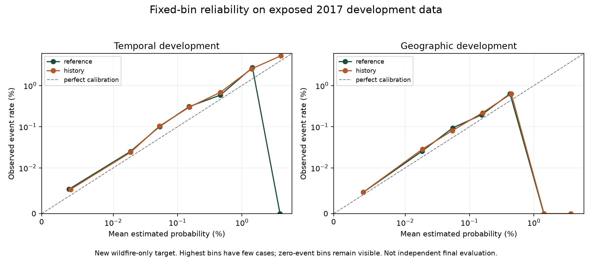

# Weather-history feature experiment

November 1, 2026. Completed **12 forward-fold fits and six development refits with separate calibration**. This implements the next experiment registered after the missed-fire audit. No serving model, old final prediction, original target panel or earlier evaluation artifact was replaced.

## Decision

Keep the application defaults. Weather-history features improved geographic average precision and probability losses in the exposed 2017 diagnostic, but they found **no additional positive cell-days at the fixed 1% daily review capacity**. The temporal history candidate also worsened log loss slightly and did not win temporal selection folds. No candidate passed the full development adoption rule, and no genuinely untouched evaluation has been scored.

## Target and chronological contract

A new `wildfire_explicit_PB_excluded_v1` target excludes only explicit `fire_type=PB`, `is_prescribed=PB` or `cause=H-PB` events. Human-caused and unknown-cause events remain eligible. Nine source event records are excluded over 2010–2017; 126 unknown-cause records are retained. All five fire-history predictors are rebuilt from retained events strictly before each target date, using the original same-cell and 3-by-3 neighboring-cell windows. The legacy panels remain unchanged. Original binary targets were checked against their full event source before relabeling.

The eight years retain 9,673 cells and 184 fire-season dates per year. The 2017 temporal target has **734** positive cell-days, compared with **736** in the old target. The held geographic target still has 92 positives. This is a **different target/refit**: do not describe the new reference's 2/92 versus the old audit's 0/92 as a gain caused by weather-history features. The valid feature comparison is **2 versus 2 within this experiment**.

At target day t, existing weather columns represent observations from t-1. Added features are 3-/7-day FWI and DMC means and endpoint changes through t-1. Complete means require every day; endpoint deltas require their exact dated endpoints. Counts and incomplete-window flags are added in the third specification. Missing dates are reindexed as missing; the start of each fire season has incomplete windows rather than invented April observations. No current fuel/forest map is backfilled into the historical years. Historical archive publication availability is still not established by these observation-date checks.

## Comparison design

Three fixed LightGBM specifications share the new target, original hyperparameters, all positive fitting rows, deterministic 1% negative sampling and population-corrected weights: reference inputs; reference plus eight history values; and history plus eight window quality indicators. No new hyperparameter search was performed. The geographic protocol excludes inner-validation, buffer and outer-reserved cells from fitting and excludes all fire-history predictors.

Selection folds fit 2010–2013 to validate 2014 and fit 2010–2014 to validate 2015. A candidate needs higher mean AP, no lower mean fixed-capacity recall and no fold AP below 90% of the reference. The selection freeze chose the reference temporally and history geographically **before 2017 diagnostic scoring**. Development refits use 2010–2015, calibration uses 2016 (only training geography for the spatial bundle), and diagnostic scoring uses exposed 2017 data. All three fixed specifications are reported for transparency; this does not permit choosing a different candidate after seeing 2017.

## Exposed 2017 development results

| Protocol | Candidate | AP | Hits/positives | Recall | Precision | Brier | Log loss |
|---|---|---:|---:|---:|---:|---:|---:|
| temporal | reference | 0.00425853 | 66/734 | 8.99% | 0.370% | 0.000411579 | 0.003233275 |
| temporal | history | 0.00443620 | 66/734 | 8.99% | 0.370% | 0.000411557 | 0.003235728 |
| temporal | history_quality | 0.00443620 | 66/734 | 8.99% | 0.370% | 0.000411557 | 0.003235728 |
| inner_spatial | reference | 0.00232426 | 2/92 | 2.17% | 0.084% | 0.000396706 | 0.003185401 |
| inner_spatial | history | 0.00284508 | 2/92 | 2.17% | 0.084% | 0.000396578 | 0.003147722 |
| inner_spatial | history_quality | 0.00284508 | 2/92 | 2.17% | 0.084% | 0.000396578 | 0.003147722 |

Temporal comparisons each use 17,848 review slots. Geographic comparisons each use 2,392. The quality-indicator version has the same reported metrics as history; none of its eight additional quality fields was used in a fitted split in the saved refits. This is evidence to favor the simpler candidate for further research, not permission to remove source-quality provenance.

The paired seven-day block bootstrap gives a temporal recall-change interval of **[-0.929, +0.856] percentage points**, and a geographic interval of **[-3.615, +3.030] percentage points**. Both observed aggregate changes are zero. The candidates can find different cases despite equal total counts. These are conditional development uncertainty estimates; they do not account for all earlier exploratory choices or establish geographic equivalence.



The fixed-bin reliability tables preserve sample/positive counts. High-probability bins have sparse support; zero-event bins remain visible. Many populated bins have event rates above estimated probabilities. A tiny Brier score in a rare-event problem is not proof that probabilities are operationally reliable.

## Evidence, reproduction and remaining work

`protocol.json` was written before fitting. `target_audit.json`, `rolling_results.json`, `selection_freeze.json`, six daily-capacity CSVs, reliability tables, monthly support, `results.json`, `cache_manifest.json`, `verification.json` and `source/` provide the audit trail. Models and full derived year panels remain local under `data/processed/weather_history_2026-11-01`; they are not in Git or the older submission ZIP. Source snapshots identify the exact executed feature code.

From `github_iteration_1/prototype_iteration_1` with the pinned full workspace restored:

```sh
../../.venv/bin/python -m scripts.weather_history_experiment --workspace ../.. --output-dir ../../reports/weather_history_repeat_01 --cache-dir ../../data/processed/weather_history_repeat_01
```

Use fresh directories. The old 2018/2019 final periods, selected 2025 finals and spread holdout outputs are not fitted, retuned or rescored. A prospective **May–October 2027** evaluation reservation was recorded before this experiment's scoring. It is not an acquired dataset or a completed clean test. Freeze the candidate, target and source contracts before accessing those labels; verify future source vintages and completeness. The existing 2017/2019/2025 results cannot become a new clean test by being renamed.

The next model task should address geographic transfer with source-appropriate spatial information or a longer, correctly dated weather history and a new registered hypothesis. This completed ablation alone does not support expanding the frontend or promoting a model.
